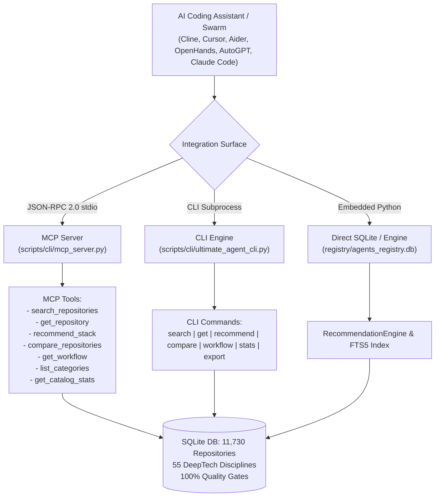

# AI Coding Assistant & Model Context Protocol (MCP) Integration Guide

This guide establishes the official integration architecture, framework taxonomy, agent recipes, and discovery schemas enabling AI coding assistants, autonomous swarms, and orchestrators to programmatically consume **Github-Ultimate-Repos** (11,730 verified repositories across 55 disciplines).

---

## 1. Architectural Overview & Catalog Taxonomy

The catalog indexes **11,730 audited open-source repositories**, complete with full-text search (SQLite FTS5), multi-factor recommendation scoring, and verified 1-line architectural workflow pipelines.



### Key Cataloged Frameworks by Domain

| Category / Role | Top Starred Frameworks in Catalog | Stars | Focus & Integration Value |
| :--- | :--- | :--- | :--- |
| **Autonomous Coding Agents** | `anomalyco/opencode` | 221,306★ | Open-source agentic coding harness |
| | `Significant-Gravitas/AutoGPT` | 187,737★ | Goal-driven autonomous multi-agent platform |
| | `anthropics/claude-code` | 153,330★ | Terminal agent with deep codebase understanding |
| | `farion1231/cc-switch` | 148,459★ | Desktop multi-agent switcher (Claude Code, Codex, OpenCode) |
| | `openai/codex` | 130,838★ | Terminal-first coding agent engine |
| | `earendil-works/pi` | 117,672★ | Agent loop, TUI, coding CLI toolkit |
| | `stablyai/orca` | 105,206★ | Agent fleet management runtime |
| | `OpenHands/OpenHands` | 91,775★ | Sandboxed full-stack software development agent |
| | `cline/cline` | 70,839★ | Autonomous coding agent IDE extension / CLI with MCP support |
| | `AntonOsika/gpt-engineer` | 55,005★ | Natural language to production codebase generation |
| | `Aider-AI/aider` | 49,744★ | Pair-programming in terminal with repo map & git commits |
| | `QwenLM/qwen-code` | 28,707★ | Open-source terminal agent |
| | `RooCodeInc/Roo-Code` | 24,263★ | Multi-agent dev team inside VS Code |
| | `princeton-nlp/SWE-agent` | 19,410★ | Autonomous software engineering benchmark solver |
| **MCP Ecosystem & Protocol** | `punkpeye/awesome-mcp-servers` | 96,838★ | Curated directory of Model Context Protocol servers |
| | `modelcontextprotocol/servers` | 91,547★ | Anthropic reference MCP servers (filesystem, git, sqlite, postgres) |
| | `cheaper-inference/OmniRoute` | 80,903★ | AI gateway with 375 providers and native MCP/A2A bridging |
| | `headroomlabs-ai/headroom` | 77,760★ | Output compression for tool calling (20-95% token savings) |
| | `decolua/9router` | 31,373★ | Router bridging Cline, Cursor, Codex, and Copilot |
| **Cursor Rules & Agent Directives**| `affaan-m/ECC` | 288,325★ | Agent harness optimization: instincts, memory, skills, security |
| | `x1xhlol/system-prompts-and-models`| 144,236★ | System prompts and operational rules of top AI coding tools |
| | `VoltAgent/awesome-design-md` | 123,388★ | Brand DESIGN.md specifications for coding agents |
| | `asgeirtj/system_prompts_leaks`| 70,167★ | Documented prompts for Claude Code, Cursor, Codex |
| | `PatrickJS/awesome-cursorrules`| 41,019★ | Curated repository of `.cursorrules` configurations |
| | `google-labs-code/design.md` | 28,522★ | Visual identity and engineering specification for coding agents |
| **Autonomous Swarms & Teams** | `bytedance/deer-flow` | 84,397★ | Long-horizon SuperAgent harness with sandboxes & memory |
| | `666ghj/MiroFish` | 81,757★ | Swarm intelligence & OASIS simulation engine |
| | `ruvnet/ruflo` | 79,119★ | Multi-player autonomous agent swarm coordinator |
| | `FoundationAgents/MetaGPT` | 71,010★ | Multi-agent software company role simulation (PM, Arch, QA) |
| | `microsoft/autogen` | 61,554★ | Multi-agent conversation framework |
| | `crewAIInc/crewAI` | 60,081★ | Role-playing collaborative agent framework |
| | `OpenBMB/ChatDev` | 34,587★ | Communicative virtual software team |
| | `openai/swarm` | 22,077★ | Lightweight educational agent orchestration |

---

## 2. Integration Recipes for AI Coding Assistants

### Recipe 1: Native Model Context Protocol (MCP) Server

The repository includes a zero-dependency, high-throughput MCP standard server:
```
scripts/cli/mcp_server.py
```
This server implements the MCP JSON-RPC 2.0 specification (`2024-11-05`) over `stdio`.

#### Stdio MCP Client Configurations

##### Claude Desktop (`%APPDATA%\Claude\claude_desktop_config.json`)
```json
{
  "mcpServers": {
    "github-ultimate-repos": {
      "command": "python",
      "args": [
        "C:\\Users\\Aryan\\Github-Ultimate-Repos\\scripts\\cli\\mcp_server.py"
      ],
      "env": {
        "PYTHONIOENCODING": "utf-8"
      }
    }
  }
}
```

##### Cursor IDE (`.cursor/mcp.json` or Global Features Settings)
```json
{
  "mcpServers": {
    "github-ultimate-repos": {
      "command": "python",
      "args": ["C:/Users/Aryan/Github-Ultimate-Repos/scripts/cli/mcp_server.py"],
      "transport": "stdio"
    }
  }
}
```

##### Antigravity CLI / Gemini MCP Configuration
```json
{
  "mcpServers": {
    "github-ultimate-repos": {
      "command": "python",
      "args": ["C:\\Users\\Aryan\\Github-Ultimate-Repos\\scripts\\cli\\mcp_server.py"],
      "transport": "stdio"
    }
  }
}
```

##### Cline / Roo-Code (`cline_mcp_settings.json`)
```json
{
  "mcpServers": {
    "github-ultimate-repos": {
      "command": "python",
      "args": [
        "C:\\Users\\Aryan\\Github-Ultimate-Repos\\scripts\\cli\\mcp_server.py"
      ],
      "env": {
        "PYTHONIOENCODING": "utf-8"
      },
      "disabled": false,
      "autoApprove": [
        "search_repositories",
        "get_repository",
        "get_repository_details",
        "recommend_stack",
        "recommend_repositories",
        "compare_repositories",
        "get_workflow",
        "list_categories",
        "get_catalog_stats"
      ]
    }
  }
}
```

#### Available MCP Tools & Aliases
1. `search_repositories(query, category?, min_stars?, limit?)` — Full-text SQLite FTS5 search across all 11,730 verified repositories.
2. `get_repository(name)` / `get_repository_details(name)` — Complete dossier (architecture workflow pipeline, quality gate verification, stars, forks, license).
3. `recommend_stack(intent, category?, lang?, min_stars?, limit?)` / `recommend_repositories(intent, ...)` — Explainable multi-factor scoring (relevance, architecture fit, maturity, language match).
4. `compare_repositories(repos)` — Side-by-side architectural matrix comparing 2 to 3 candidate frameworks.
5. `get_workflow(name?)` — Verified production workflow DAGs (AI agents, RAG, cloud-native, mobile, SaaS MVP).
6. `list_categories()` — 55 DeepTech disciplines breakdown with repository volumes and star distribution.
7. `get_catalog_stats()` — Global catalog intelligence, health metrics, and quality gate status.

#### Available MCP Resources
- `ultimate-repos://stats` — Aggregated catalog metrics and telemetry.
- `ultimate-repos://categories` — Complete taxonomy of 55 DeepTech disciplines.
- `ultimate-repos://workflows/ai-agent` — 4-stage verified production multi-agent engineering workflow.

---

### Recipe 2: Cline & Roo-Code Custom Modes

Configure Roo-Code / Cline with a dedicated **DeepTech Software Architect Mode** in `.roomodes`:

```json
{
  "customModes": [
    {
      "slug": "deeptech-architect",
      "name": "DeepTech Software Architect",
      "roleDefinition": "You are an elite enterprise software architect with direct access to the 11,730 verified repositories and architectural workflows in Github-Ultimate-Repos via MCP tools.",
      "groups": ["read", "browser", "command", "mcp"],
      "customInstructions": "Before selecting libraries, recommending frameworks, or designing system architectures, ALWAYS query 'github-ultimate-repos' MCP server using 'recommend_stack' or 'search_repositories'. Cite verified repository stargazers, architecture workflows, and category IDs."
    }
  ]
}
```

---

### Recipe 3: Cursor Rules (`.cursorrules` / `.cursor/rules/*.mdc`)

Create `.cursor/rules/ultimate-repos.mdc` in your workspace:

```markdown
---
description: DeepTech Architecture & Repository Verification Rule
globs: ["**/*"]
alwaysApply: true
---

# Enterprise Architecture & Repository Selection Standard

When implementing features, selecting dependencies, or designing software subsystems:
1. **Catalog Lookup**: Consult the local `Github-Ultimate-Repos` registry located at `C:\Users\Aryan\Github-Ultimate-Repos`.
2. **Execute Lookup via CLI**:
   ```bash
   python C:\Users\Aryan\Github-Ultimate-Repos\scripts\cli\ultimate_agent_cli.py recommend "<task description>" --limit 3
   ```
3. **Inspect Architecture Workflow**:
   ```bash
   python C:\Users\Aryan\Github-Ultimate-Repos\scripts\cli\ultimate_agent_cli.py get "<repo_name>"
   ```
4. **Architectural Conformity**: Follow the verified 1-line architectural workflow pipeline provided in the repository record.
```

---

### Recipe 4: Aider AI Pair-Programming Integration

Configure `.aider.conf.yml` to automatically integrate the repository catalog:

```yaml
# .aider.conf.yml
read:
  - C:\Users\Aryan\Github-Ultimate-Repos\docs\agent-catalog.md
  - C:\Users\Aryan\Github-Ultimate-Repos\schemas\repository_schema.json

# Custom commands or alias hooks
alias:
  repo-search: "/run python C:\\Users\\Aryan\\Github-Ultimate-Repos\\scripts\\cli\\ultimate_agent_cli.py search"
  repo-recommend: "/run python C:\\Users\\Aryan\\Github-Ultimate-Repos\\scripts\\cli\\ultimate_agent_cli.py recommend"
  repo-workflow: "/run python C:\\Users\\Aryan\\Github-Ultimate-Repos\\scripts\\cli\\ultimate_agent_cli.py workflow"
```

In an Aider terminal session:
```bash
/repo-recommend "build a high-performance vector retrieval engine with python"
```

---

### Recipe 5: OpenHands & SWE-Agent Sandbox Integration

For autonomous agent harnesses running inside sandboxed environments (Docker, Podman, microVMs), mount the repository registry as a read-only volume or query it via a local loopback MCP endpoint.

#### OpenHands Agent Hook (`agent_skills.py`):
```python
import subprocess
import json

def query_ultimate_repos(intent: str, limit: int = 5) -> dict:
    """Invoked by OpenHands agent to fetch vetted open-source components."""
    cmd = [
        "python",
        "C:\\Users\\Aryan\\Github-Ultimate-Repos\\scripts\\cli\\ultimate_agent_cli.py",
        "recommend", intent,
        "--limit", str(limit)
    ]
    res = subprocess.run(cmd, capture_output=True, text=True, encoding="utf-8")
    return {"stdout": res.stdout}
```

---

### Recipe 6: Multi-Agent Swarms (AutoGPT / CrewAI / LangGraph)

Integrate `RecommendationEngine` directly into agent tools:

```python
from crewai.tools import tool
import sys
import os

sys.path.insert(0, r"C:\Users\Aryan\Github-Ultimate-Repos\scripts\engine")
from recommendation_engine import RecommendationEngine

engine = RecommendationEngine(r"C:\Users\Aryan\Github-Ultimate-Repos\registry\agents_registry.db")

@tool("RecommendOpenSourceStack")
def recommend_open_source_stack(intent: str) -> str:
    """Recommend production-ready verified open source repositories from 11,730 cataloged assets."""
    results = engine.recommend(query=intent, limit=3)
    formatted = []
    for r in results:
        formatted.append(
            f"- {r['name']} ({r['stars']}★ | {r['language']}): {r['description']}\n  Workflow: {r['workflow']}"
        )
    return "\n\n".join(formatted)
```

---

## 3. Programmatic Schemas

The following formal Draft-07 schemas are published in the `schemas/` directory:

1. **`schemas/repository_schema.json`**: Standard record format for all 11,730 cataloged repositories.
2. **`schemas/agent_schema.json`**: Standard specification for autonomous agent capability blueprints.
3. **`schemas/workflow_schema.json`**: Formal schema for multi-stage end-to-end development workflow DAGs.
4. **`schemas/stack_blueprint_schema.json`**: Turnkey technology stack blueprint contract with SLAs and failure mitigations.
5. **`schemas/comparison_schema.json`**: Specification for side-by-side repository comparison matrices and decision guides.
6. **`schemas/taxonomy_schema.json`**: Classification schema for the 55 DeepTech disciplines, clusters, and boundaries.
7. **`schemas/mcp_tools_schema.json`**: Formal MCP tool schema definitions and input arguments.
8. **`schemas/agent_discovery_schema.json`**: Autonomous agent discovery contract specifying endpoints, query parameters, and response formats.

---

## 4. Verification & Testing

Verify MCP integration and CLI suite:
```bash
# Run unit and integration test suite
python -m unittest discover -s tests

# Verify MCP Server over stdio
python tests/integration/test_mcp_server.py

# Verify CLI search and recommendation
python scripts/cli/ultimate_agent_cli.py search "mcp server" --limit 5
python scripts/cli/ultimate_agent_cli.py recommend "autonomous multi-agent coding swarm" --limit 3
```
