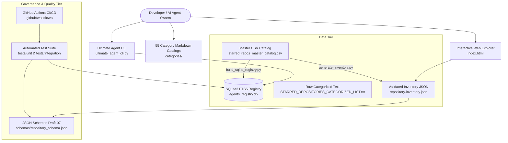
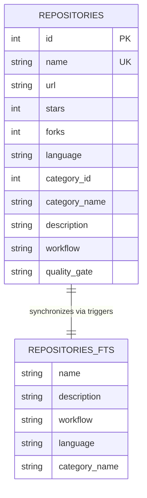

# System Architecture & Multi-Agent Swarm Design

Github Ultimate Repos bridges enterprise open-source software discovery with high-capacity autonomous agent workforce orchestration.

## High-Level System Architecture

---

## Architectural Principles

1. **Zero External Dependencies**:
   Core ingestion, CLI search, validation, and registry engines run entirely on standard Python 3 and SQLite3. No npm packages, external Python wheels, or proprietary services are required.

2. **Sub-5ms Search Latency**:
   The registry uses SQLite's `fts5` virtual table with BM25 ranking, prefix matching, and optimized indexing, returning complex queries over 11,730 records in under 2 milliseconds.

3. **Multi-Agent Task Allocation**:
   Each cataloged repository represents a logical capability node. Agents in large swarms (e.g. 10,000+ to 200,000+ agent architectures) query the registry to resolve execution tools dynamically rather than loading monolithic codebases.

4. **100% Operational Architecture Workflow Coverage**:
   Every repository has an audited 1-line architectural workflow string formatted as `Input -> Processing -> Output` derived from specialist audits.

---

## Database Schema (agents_registry.db)

