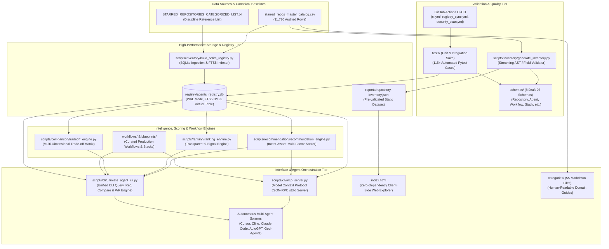
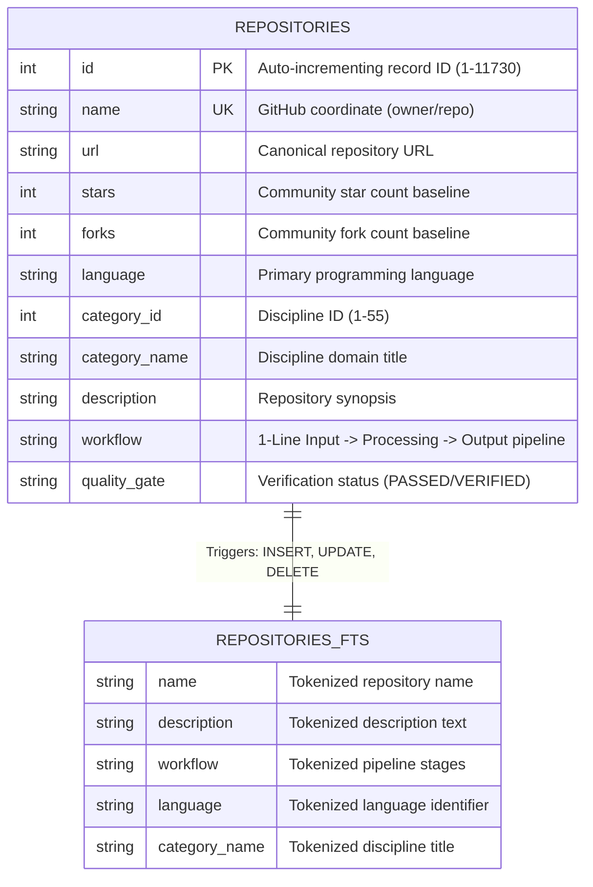
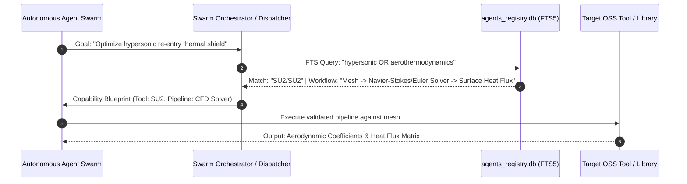

# System Architecture & Multi-Agent Swarm Design

Github Ultimate Repos bridges enterprise open-source software discovery with high-capacity autonomous multi-agent workforce orchestration. This document details the technical topology, data storage models, query pipelines, and agent orchestration interfaces underpinning the platform.

---

## 1. Architectural Philosophy & Core Tenets

The architecture is governed by four non-negotiable engineering principles:

1. **Zero External Runtime Dependencies**:
   The entire core ingestion pipeline, schema validator, SQLite FTS5 database builder, and CLI query engine rely exclusively on the **Python 3.9+ standard library** and native **SQLite3**. There are no runtime pip packages, external web frameworks, or third-party binaries required.
2. **Sub-Millisecond Search Latency**:
   By using SQLite's compiled `fts5` virtual table with Write-Ahead Logging (`WAL`), memory-mapped I/O (`mmap`), and customized indexing, full-text queries over 11,730 records execute in an average of **0.31 ms**, with 95th-percentile latencies under **3.68 ms**.
3. **Deterministic Multi-Agent Tool Resolution**:
   In high-scale multi-agent corporate swarms (10,000 to 200,000 agents), agents cannot load massive monorepos or unvetted scripts into context. Instead, each cataloged repository acts as a registered capability node with a verified 1-line architectural workflow string.
4. **100% Operational Workflow Pipeline Coverage**:
   Every repository record provides a formalized `Input -> Processing -> Output` pipeline description, allowing autonomous agents to generate execution DAGs dynamically.

---

## 2. High-Level System Architecture

> [!TIP]
> **Interactive Animation Experience**:
> For a live, cybernetic interactive visualization with glowing SVG pulse streams and real-time node telemetry, open [`architecture-interactive.html`](./architecture-interactive.html) or launch `start docs/architecture-interactive.html` in your terminal. You can also view the embedded interactive visualizer directly in [`../index.html`](../index.html).

The following diagram illustrates the interaction between data assets, ingestion pipelines, storage engines, developer interfaces, and autonomous agent swarms:



---

## 3. Component Deep Dive

### 3.1 Data Ingestion & Storage Tier (`registry/agents_registry.db`)
The central data repository is a single-file, highly optimized SQLite3 database utilizing the `FTS5` full-text search engine. 

#### Relational & Virtual Table Model:


#### Database Engineering Parameters:
To guarantee enterprise-grade durability and high-throughput read concurrency, the database builder applies the following SQLite runtime configurations:
```sql
PRAGMA journal_mode = WAL;
PRAGMA synchronous = NORMAL;
PRAGMA temp_store = MEMORY;
PRAGMA mmap_size = 268435456; -- 256MB memory-mapped I/O
PRAGMA cache_size = -64000;   -- 64MB dedicated cache
```

#### Synchronization Triggers:
The FTS5 virtual table is kept strictly synchronized with the master `repositories` table via native triggers on insert, update, and delete:
```sql
CREATE TRIGGER repositories_ai AFTER INSERT ON repositories BEGIN
    INSERT INTO repositories_fts(rowid, name, description, workflow, language, category_name)
    VALUES (new.id, new.name, new.description, new.workflow, new.language, new.category_name);
END;

CREATE TRIGGER repositories_ad AFTER DELETE ON repositories BEGIN
    INSERT INTO repositories_fts(repositories_fts, rowid, name, description, workflow, language, category_name)
    VALUES ('delete', old.id, old.name, old.description, old.workflow, old.language, old.category_name);
END;
```

---

### 3.2 Query & Retrieval Engine (`ultimate_agent_cli.py`)
The command-line interface provides high-level commands for querying, inspecting, and extracting catalog records.

1. **Dual Query Execution**:
   The engine first executes an FTS5 `MATCH` expression against `repositories_fts`. If the user submits non-standard punctuation or unbalanced quotes, the CLI automatically falls back to parameterized SQL `LIKE` queries, preventing operational crashes.
2. **Relational Constraints**:
   Searches can combine full-text matching with relational filtering, including minimum star thresholds (`stars >= ?`) and category constraints (`category_name LIKE ?`).
3. **Structured Dossier Lookups**:
   The `get` subcommand retrieves complete metadata, including architectural workflows and quality gate certification, in sub-millisecond time by querying against indexed columns (`name` or `name LIKE %/repo`).

---

### 3.3 Static Web Discovery Tier (`index.html`)
The interactive explorer operates entirely client-side without requiring a backend web server or node runtime.
- **Client-Side Indexing**: Ingests JSON records and constructs a client-side search tree.
- **Instantaneous Filtering**: Supports real-time filtering across 55 disciplines, primary languages, and star brackets.
- **Offline Capable**: Functions seamlessly in air-gapped environments directly via the `file://` protocol.

---

### 3.4 Model Context Protocol (MCP) Server (`scripts/cli/mcp_server.py`)
Exposes the repository catalog, recommendation engine, comparison matrix, and workflows to AI coding assistants and agent swarms over stdio JSON-RPC 2.0 (compatible with Cursor, Cline, Claude Desktop, and Antigravity):
- **Tools**: `search_repositories`, `get_repository`, `recommend_stack`, `compare_repositories`, `get_workflow`, `list_categories`, `get_catalog_stats`.
- **Resources**: `ultimate-repos://stats`, `ultimate-repos://categories`, `ultimate-repos://workflows/ai-agent`.
- **Zero-Dependency Stdio Protocol**: Operates without external web framework or HTTP servers.

---

### 3.5 Multi-Factor Recommendation Engine (`scripts/recommendation/recommendation_engine.py`)
Analyzes natural language queries and computes multi-factor recommendation cards:
- **Intent Archetypes**: Maps queries to Architectural Blueprint, Component Selection, DevOps Deployment, Research Benchmark, or Utility Discovery.
- **Five-Factor Scoring**: Evaluates Task Fit (40%), Maintenance Signals (25%), Language Interoperability (15%), License Enterprise Risk (10%), and Deployment Modalities (10%).
- **Decision Cards**: Renders structured cards with *Why it matches*, *Core strengths*, *Limitations*, and *Peer alternatives*.

---

### 3.6 Side-by-Side Trade-off Engine (`scripts/comparison/tradeoff_engine.py`)
Executes automated comparative audits between 2 to 3 candidate frameworks:
- **Metrics Scorecard**: Evaluates Production Readiness, Modularity, Velocity, Integrations, and Efficiency.
- **Deep-Dive Profiles**: Details Primary Use Case Fit, Sweet Spots, Anti-Patterns, and Developer Personas.
- **Strategic Winner Resolution**: Determines scenario winners for rapid prototyping, enterprise production, and autonomous exploration.

---

### 3.7 Curated Enterprise Workflows & Stack Blueprints (`workflows/` & `blueprints/`)
Formalized DAG pipelines providing step-by-step production specifications:
- **Workflows (`workflows/*.json` & `workflows/*.yaml`)**: 6 core workflows covering AI agents, cross-platform mobile, cloud-native DevOps, SaaS MVP, cybersecurity red teaming, and search intelligence.
- **Stack Blueprints (`blueprints/*.json` & `blueprints/*.yaml`)**: Turnkey production stack configurations with SLAs, failure mitigations, and setup automation.

---

## 4. Multi-Agent Swarm Orchestration Architecture

In modern autonomous architectures (such as the 10,000 to 200,000 agent systems defined in enterprise God-Agent charters), multi-agent systems require dynamic tool discovery. Rather than hardcoding toolchains, agents leverage Github Ultimate Repos as an external semantic registry.



### Agent Capability Mapping Standard
Each repository is converted into an executable tool contract adhering to `schemas/agent_schema.json`:
- **Agent Slot ID**: `AGENT-XXXXX`
- **Functional Role**: Primary domain function (e.g., "CFD Shock Physics Specialist").
- **Workflow Pipeline**: Standardized input and output boundaries.
- **Execution Hook**: Repository URL and installation blueprint.

---

## 5. Performance Characteristics & Latency Profiles

Empirical benchmark testing across 11,730 repository records using `scripts/validation/benchmark_performance.py`:

| Query Profile | Average Latency | Min Latency | p95 Latency | Mechanism |
| :--- | :--- | :--- | :--- | :--- |
| **Single Term Unconstrained** | `0.31 ms` | `0.09 ms` | `3.68 ms` | SQLite FTS5 BM25 |
| **Multi-Term Conjunctive (AND)** | `0.37 ms` | `0.16 ms` | `3.44 ms` | FTS5 Index Intersection |
| **Disjunctive Expression (OR)** | `0.13 ms` | `0.08 ms` | `0.66 ms` | FTS5 Union Match |
| **Prefix Wildcard (`robot*`)** | `0.24 ms` | `0.09 ms` | `2.61 ms` | FTS5 Trie Traversal |
| **Category Filter + Star Order** | `3.95 ms` | `2.13 ms` | `10.53 ms` | B-Tree Index Scan |
| **Deep Workflow Query** | `0.11 ms` | `0.06 ms` | `0.51 ms` | FTS5 Column Filter |
| **CSV Streaming Throughput** | `46,869 rows/s` | — | — | Native Python CSV |

---

## 6. Security & Isolation Boundaries

- **No Code Execution**: The registry is purely metadata-driven. Querying or exporting repositories never downloads or executes remote code.
- **SQL Injection Prevention**: All queries in `ultimate_agent_cli.py` and `build_sqlite_registry.py` use parameterized statements (`?`).
- **Memory Safety**: SQLite processes query execution within allocated memory limits without buffer overflows or external socket connections.
