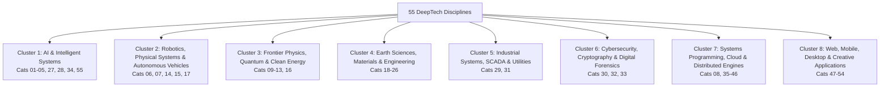

# DeepTech & Enterprise Category Taxonomy (55 Disciplines)

Github Ultimate Repos classifies **11,730 open-source repositories and agent blueprints** into **55 granular DeepTech and enterprise software disciplines**.

This taxonomy eliminates ambiguous grouping by providing distinct domain boundaries, strict inclusion criteria, and clear disambiguation rules.

---

## 1. Taxonomy Architecture & Domain Clusters

The 55 disciplines are structured into **8 High-Level Enterprise Domain Clusters**:

---

## 2. Complete 55-Discipline Reference Table

| ID | Official Discipline Title | Parent Domain Cluster | Repositories | Stars | Primary Keywords & Stacks |
| :---: | :--- | :--- | :---: | :---: | :--- |
| **01** | [Curated Knowledge, Developer Guides, Books & Awesome Collections](../categories/01_curated_knowledge_developer_gu.md) | `AI & Intelligent Systems` | **689** | 16,178,214★ | `awesome-list, developer-roadmap, computer-science-curriculum, free-programming-books, public-apis` |
| **02** | [Artificial Intelligence, Large Language Models, Foundation Models & Quantization](../categories/02_artificial_intelligence_large_.md) | `AI & Intelligent Systems` | **1,101** | 22,083,549★ | `llm, transformers, foundation-models, quantization, gguf` |
| **03** | [Multi-Agent Systems, Autonomous Swarms, AI Orchestration & MCP Tools](../categories/03_multi_agent_systems_autonomous.md) | `AI & Intelligent Systems` | **303** | 7,471,295★ | `multi-agent, autonomous-agents, mcp, langchain, crewai` |
| **04** | [Computer Vision, Multimodal AI, Diffusion & Neural Rendering (NeRF/3D-GS)](../categories/04_computer_vision_multimodal_ai_.md) | `AI & Intelligent Systems` | **84** | 1,108,140★ | `computer-vision, diffusion-models, stable-diffusion, comfyui, nerf` |
| **05** | [Speech, Voice AI, Audio Processing, Audio Synthesis & Music Generation](../categories/05_speech_voice_ai_audio_processi.md) | `AI & Intelligent Systems` | **46** | 698,744★ | `speech-recognition, tts, whisper, voice-cloning, audio-synthesis` |
| **06** | [Robotics, Humanoid Kinematics, Dynamics, Actuators & Physics Simulation](../categories/06_robotics_humanoid_kinematics_d.md) | `Robotics, Physical Systems & Autonomous Vehicles` | **39** | 318,945★ | `robotics, humanoid, kinematics, dynamics, mujoco` |
| **07** | [Autonomous Vehicles, Mobile Robotics, LiDAR SLAM & Drone Flight Control](../categories/07_autonomous_vehicles_mobile_rob.md) | `Robotics, Physical Systems & Autonomous Vehicles` | **25** | 377,437★ | `autonomous-vehicles, slam, lidar, autoware, point-cloud` |
| **08** | [Semiconductor, Silicon EDA, RTL-to-GDSII, FPGA & RISC-V Architecture](../categories/08_semiconductor_silicon_eda_rtl_.md) | `Systems Programming, Cloud & Distributed Engines` | **34** | 225,293★ | `eda, semiconductor, riscv, verilog, openlane` |
| **09** | [Quantum Computing, Quantum Algorithms, Circuit Simulation & Error Correction](../categories/09_quantum_computing_quantum_algo.md) | `Frontier Physics, Quantum & Clean Energy` | **9** | 21,525★ | `quantum-computing, qiskit, cirq, pennylane, quantum-algorithms` |
| **10** | [Superconducting Systems, Cryogenics & Energy Storage (SMES)](../categories/10_superconducting_systems_cryoge.md) | `Frontier Physics, Quantum & Clean Energy` | **10** | 484★ | `superconductivity, cryogenics, smes, hts, vortex-dynamics` |
| **11** | [Spintronics, Micromagnetics & Atomistic Spin Dynamics (LLG)](../categories/11_spintronics_micromagnetics_ato.md) | `Frontier Physics, Quantum & Clean Energy` | **7** | 377★ | `spintronics, micromagnetics, mumax3, oommf, spin-dynamics` |
| **12** | [Nuclear Fusion, Plasma Physics, Tokamaks & Particle Accelerators](../categories/12_nuclear_fusion_plasma_physics_.md) | `Frontier Physics, Quantum & Clean Energy` | **11** | 1,555★ | `nuclear-fusion, plasma-physics, tokamak, mhd, particle-in-cell` |
| **13** | [Clean Energy, Solid Oxide Fuel Cells, Batteries & Power Grids](../categories/13_clean_energy_solid_oxide_fuel_.md) | `Frontier Physics, Quantum & Clean Energy` | **5** | 4,171★ | `clean-energy, pybamm, battery-simulation, fuel-cells, electrochemical` |
| **14** | [Space Systems, Orbital Astrodynamics, Satellite Tracking & Rocket Propulsion](../categories/14_space_systems_orbital_astrodyn.md) | `Robotics, Physical Systems & Autonomous Vehicles` | **13** | 1,941★ | `space-systems, astrodynamics, orekit, poliastro, orbital-mechanics` |
| **15** | [Spacecraft Proximity Operations, Docking & Deployable Structures](../categories/15_spacecraft_proximity_operation.md) | `Robotics, Physical Systems & Autonomous Vehicles` | **3** | 47★ | `proximity-operations, spacecraft-docking, relative-navigation, clohessy-wiltshire, rendezvous` |
| **16** | [Gravitational Wave Astronomy, Precision Metrology & Casimir Physics](../categories/16_gravitational_wave_astronomy_p.md) | `Frontier Physics, Quantum & Clean Energy` | **4** | 689★ | `gravitational-waves, pycbc, gwpy, metrology, interferometry` |
| **17** | [Aerospace Aerodynamics, Hypersonics & Rarefied Gas Dynamics](../categories/17_aerospace_aerodynamics_hyperso.md) | `Robotics, Physical Systems & Autonomous Vehicles` | **12** | 22,500★ | `aerodynamics, hypersonics, su2, dsmc, shock-waves` |
| **18** | [Computational Fluid Dynamics (CFD), Turbulence & Multiphase Slosh](../categories/18_computational_fluid_dynamics_c.md) | `Earth Sciences, Materials & Engineering` | **17** | 26,580★ | `cfd, openfoam, fluid-dynamics, turbulence, navier-stokes` |
| **19** | [Peridynamics, Structural Mechanics, FEA & Non-Local Fracture](../categories/19_peridynamics_structural_mechan.md) | `Earth Sciences, Materials & Engineering` | **7** | 25,606★ | `peridynamics, structural-mechanics, fea, finite-element, fracture-mechanics` |
| **20** | [Additive Manufacturing, Laser Powder Bed Fusion (LPBF) & 3D Slicing](../categories/20_additive_manufacturing_laser_p.md) | `Earth Sciences, Materials & Engineering` | **9** | 44,508★ | `additive-manufacturing, 3d-printing, lpbf, slicing, melt-pool` |
| **21** | [Terrestrial Laser Scanning (TLS) & Structural Health Monitoring (SHM)](../categories/21_terrestrial_laser_scanning_tls.md) | `Earth Sciences, Materials & Engineering` | **43** | 753,560★ | `lidar-scanning, tls, point-cloud, structural-health-monitoring, shm` |
| **22** | [Subsurface Geomechanics, Geothermal (EGS) & Nuclear Waste Vitrification](../categories/22_subsurface_geomechanics_geothe.md) | `Earth Sciences, Materials & Engineering` | **10** | 1,209★ | `geomechanics, geothermal, egs, subsurface-flow, thmc` |
| **23** | [Acoustic Levitation, Acoustofluidics & Phased Array Manipulation](../categories/23_acoustic_levitation_acoustoflu.md) | `Earth Sciences, Materials & Engineering` | **7** | 80★ | `acoustic-levitation, acoustofluidics, ultrasound, radiation-force, phased-arrays` |
| **24** | [Marine Hydrodynamics, Sonar Transducer Arrays & Ocean Engineering](../categories/24_marine_hydrodynamics_sonar_tra.md) | `Earth Sciences, Materials & Engineering` | **4** | 1,647★ | `marine-hydrodynamics, sonar, beamforming, underwater-acoustics, ocean-engineering` |
| **25** | [Atmospheric Sciences, Meteorology, LiDAR & Earth Observation](../categories/25_atmospheric_sciences_meteorolo.md) | `Earth Sciences, Materials & Engineering` | **21** | 137,516★ | `meteorology, atmospheric-science, wrf, weather-prediction, satellite-observation` |
| **26** | [Healthcare, Computational Biomedicine, Drug Discovery & Molecular Modeling](../categories/26_healthcare_computational_biome.md) | `Earth Sciences, Materials & Engineering` | **11** | 99,500★ | `drug-discovery, molecular-docking, computational-biology, biomedicine, protein-folding` |
| **27** | [Genomics, CRISPR Gene Editing & Synthetic Biology](../categories/27_genomics_crispr_gene_editing_s.md) | `AI & Intelligent Systems` | **10** | 16,365★ | `genomics, crispr, gene-editing, synthetic-biology, dna-sequencing` |
| **28** | [Neurotechnology, Brain-Computer Interfaces (BCI) & Neuromorphic Computing](../categories/28_neurotechnology_brain_computer.md) | `AI & Intelligent Systems` | **12** | 28,588★ | `bci, neurotechnology, eeg, brain-computer-interface, spike-sorting` |
| **29** | [Smart Cities, Building Information Modeling (BIM/IFC) & Urban Mobility](../categories/29_smart_cities_building_informat.md) | `Industrial Systems, SCADA & Utilities` | **14** | 146,346★ | `smart-cities, bim, ifcopenshell, urban-mobility, traffic-simulation` |
| **30** | [Cybersecurity, Reverse Engineering, Binary Exploitation & Vulnerability Research](../categories/30_cybersecurity_reverse_engineer.md) | `Cybersecurity, Cryptography & Digital Forensics` | **127** | 1,692,665★ | `cybersecurity, reverse-engineering, ghidra, binary-exploitation, fuzzing` |
| **31** | [Industrial Automation, SCADA, PLC Ladder Logic, OPC-UA & Hardware Security](../categories/31_industrial_automation_scada_pl.md) | `Industrial Systems, SCADA & Utilities` | **9** | 60,999★ | `industrial-automation, scada, plc, opc-ua, modbus` |
| **32** | [Cryptography, Zero-Knowledge Proofs (ZKP), Post-Quantum & Privacy Tech](../categories/32_cryptography_zero_knowledge_pr.md) | `Cybersecurity, Cryptography & Digital Forensics` | **4** | 73,133★ | `cryptography, zero-knowledge-proofs, zk-snarks, post-quantum, elliptic-curves` |
| **33** | [Formal Verification, Theorem Proving & Mathematical Proof Systems](../categories/33_formal_verification_theorem_pr.md) | `Cybersecurity, Cryptography & Digital Forensics` | **5** | 23,722★ | `formal-verification, theorem-proving, lean, coq, smt-solvers` |
| **34** | [EdTech, Adaptive Learning, Cognitive Scaffolding & STEM Assessment](../categories/34_edtech_adaptive_learning_cogni.md) | `AI & Intelligent Systems` | **8** | 485,646★ | `edtech, adaptive-learning, knowledge-tracing, stem-education, qti` |
| **35** | [Fintech, Core Banking, Payment Protocols & Algorithmic Trading](../categories/35_fintech_core_banking_payment_p.md) | `Systems Programming, Cloud & Distributed Engines` | **30** | 505,879★ | `fintech, algorithmic-trading, core-banking, fix-protocol, orderbook` |
| **36** | [Blockchain, Web3, Smart Contracts & EVM/Solana Engineering](../categories/36_blockchain_web3_smart_contract.md) | `Systems Programming, Cloud & Distributed Engines` | **87** | 1,319,654★ | `blockchain, web3, smart-contracts, ethereum, solana` |
| **37** | [Database Engines, Distributed SQL, NoSQL, Vector DBs & Persistent Caches](../categories/37_database_engines_distributed_s.md) | `Systems Programming, Cloud & Distributed Engines` | **291** | 5,032,498★ | `database-engines, distributed-sql, nosql, vector-database, lsm-tree` |
| **38** | [Data Engineering, Distributed Analytics, Stream Processing (Kafka/Spark) & ETL](../categories/38_data_engineering_distributed_a.md) | `Systems Programming, Cloud & Distributed Engines` | **82** | 1,212,901★ | `data-engineering, apache-spark, apache-kafka, stream-processing, lakehouse` |
| **39** | [Cloud-Native Infrastructure, Kubernetes, Containers & Service Meshes](../categories/39_cloud_native_infrastructure_ku.md) | `Systems Programming, Cloud & Distributed Engines` | **2,472** | 33,213,842★ | `cloud-native, kubernetes, containers, docker, envoy` |
| **40** | [CI/CD Automation, GitOps & Infrastructure-as-Code (Terraform/Ansible)](../categories/40_ci_cd_automation_gitops_infras.md) | `Systems Programming, Cloud & Distributed Engines` | **36** | 528,859★ | `ci-cd, gitops, infrastructure-as-code, terraform, ansible` |
| **41** | [Observability, APM Telemetry, Metrics, Distributed Tracing & Logging](../categories/41_observability_apm_telemetry_me.md) | `Systems Programming, Cloud & Distributed Engines` | **52** | 777,470★ | `observability, opentelemetry, metrics, tracing, prometheus` |
| **42** | [Networking, Reverse Proxies, Load Balancers, Edge Gateways & API Gateways](../categories/42_networking_reverse_proxies_loa.md) | `Systems Programming, Cloud & Distributed Engines` | **100** | 1,473,333★ | `networking, reverse-proxy, load-balancer, ebpf, quic` |
| **43** | [Operating Systems, Linux Kernels, Low-Level Drivers & Emulators](../categories/43_operating_systems_linux_kernel.md) | `Systems Programming, Cloud & Distributed Engines` | **86** | 1,466,920★ | `operating-systems, linux-kernel, device-drivers, hypervisor, virtual-memory` |
| **44** | [Compilers, Interpreters, Virtual Machines, Language Toolchains & JIT Engines](../categories/44_compilers_interpreters_virtual.md) | `Systems Programming, Cloud & Distributed Engines` | **121** | 2,426,516★ | `compilers, llvm, interpreters, virtual-machines, jit` |
| **45** | [Systems Programming, Low-Level Runtimes, Memory Safety & WebAssembly (Wasm)](../categories/45_systems_programming_low_level_.md) | `Systems Programming, Cloud & Distributed Engines` | **1,321** | 16,676,337★ | `systems-programming, rust, zig, cpp, memory-safety` |
| **46** | [Developer Tooling, Shell Environments, Terminal Emulators & CLI Utilities](../categories/46_developer_tooling_shell_enviro.md) | `Systems Programming, Cloud & Distributed Engines` | **164** | 3,596,484★ | `developer-tooling, shell, terminal-emulator, cli, tmux` |
| **47** | [Code Editors, IDEs, Syntax Plugins, Language Server Protocols (LSP) & Linters](../categories/47_code_editors_ides_syntax_plugi.md) | `Web, Mobile, Desktop & Creative Applications` | **138** | 2,521,567★ | `code-editors, ide, lsp, neovim, vscode` |
| **48** | [Game Development Engines, 2D/3D Graphics APIs & Shaders (WebGL/Vulkan)](../categories/48_game_development_engines_2d_3d.md) | `Web, Mobile, Desktop & Creative Applications` | **140** | 1,720,397★ | `game-development, game-engine, graphics-api, vulkan, webgpu` |
| **49** | [Modern Frontend Frameworks, Reactive Web Engines (React/Vue/Svelte) & Bundlers](../categories/49_modern_frontend_frameworks_rea.md) | `Web, Mobile, Desktop & Creative Applications` | **2,249** | 35,702,770★ | `frontend, react, vue, svelte, nextjs` |
| **50** | [UI Component Systems, Design Tokens, Iconography & Animation Libraries](../categories/50_ui_component_systems_design_to.md) | `Web, Mobile, Desktop & Creative Applications` | **84** | 1,607,526★ | `ui-components, design-tokens, tailwind, radix-ui, shadcn` |
| **51** | [Mobile App Development, Cross-Platform Frameworks (Flutter/React Native) & SDKs](../categories/51_mobile_app_development_cross_p.md) | `Web, Mobile, Desktop & Creative Applications` | **79** | 1,269,320★ | `mobile-development, flutter, react-native, ios, android` |
| **52** | [Desktop Application Frameworks, GUI Toolkits (Electron/Tauri/Qt) & Document Utilities](../categories/52_desktop_application_frameworks.md) | `Web, Mobile, Desktop & Creative Applications` | **90** | 2,007,944★ | `desktop-apps, electron, tauri, qt, gui-toolkit` |
| **53** | [Backend Web Frameworks, Microservices, REST / GraphQL / gRPC APIs & ORMs](../categories/53_backend_web_frameworks_microse.md) | `Web, Mobile, Desktop & Creative Applications` | **116** | 2,187,669★ | `backend, web-frameworks, microservices, fastapi, django` |
| **54** | [Multimedia Processing, Audio/Video Codecs, FFmpeg & Streaming Pipelines](../categories/54_multimedia_processing_audio_vi.md) | `Web, Mobile, Desktop & Creative Applications` | **51** | 1,009,638★ | `multimedia, ffmpeg, video-processing, audio-codecs, streaming` |
| **55** | [Python Ecosystem, Data Science, Scientific Computing & Analytics](../categories/55_python_ecosystem_data_science_.md) | `AI & Intelligent Systems` | **1,228** | 14,904,058★ | `python, data-science, numpy, pandas, scipy` |

---

## 3. Disambiguation & Classification Rules

When a repository spans multiple domains, classification follows a strict precedence protocol:

1. **Specific DeepTech Trumps Generic Framework**:
   *Example*: A PyTorch library specifically designed for Tokamak plasma equilibrium is assigned to **12: Nuclear Fusion, Plasma Physics, Tokamaks & Particle Accelerators**, *not* **02: Artificial Intelligence** or **55: Python Ecosystem**.
2. **Infrastructure vs Application**:
   *Example*: An orchestration tool specifically managing Kubernetes clusters is assigned to **39: Cloud-Native Infrastructure, Kubernetes, Containers & Service Meshes**, even if it exposes a web dashboard in React.
3. **Hardware & Embedded Layering**:
   *Example*: An industrial controller parsing fieldbus signals on a factory floor is categorized under **31: Industrial Automation, SCADA, PLC Ladder Logic, OPC-UA & Fieldbus Systems**, whereas the SLAM algorithm running on an autonomous vehicle is assigned to **07: Autonomous Vehicles, Mobile Robotics, LiDAR SLAM & Drone Flight Control**.
4. **Agent Orchestration vs Model Serving**:
   *Example*: Frameworks executing multi-agent prompt loops (CrewAI, AutoGPT) belong to **03: Multi-Agent Systems, Autonomous Swarms, AI Orchestration & MCP Tools**, whereas low-level model serving runtimes (vLLM, llama.cpp) belong to **02: Artificial Intelligence, Large Language Models, Foundation Models & Quantization**.

