# Contributing Guidelines & Community Engineering Standards

Thank you for your interest in contributing to **Github Ultimate Repos**! This project serves as an authoritative registry and discovery engine for leading open-source software and autonomous multi-agent capability blueprints.

To maintain our enterprise standard of quality, reproducibility, and reliability, all contributions must adhere to the standards outlined in this guide.

---

## 1. Code of Conduct

All contributors and maintainers are expected to adhere to our [Code of Conduct](../CODE_OF_CONDUCT.md). We are committed to providing a welcoming, respectful, and harassment-free environment for everyone.

---

## 2. Ways to Contribute

Contributions generally fall into one of three categories:
1. **Catalog Additions & Updates**: Proposing new high-impact repositories or updating metadata for existing entries.
2. **Core Tooling & Automation**: Enhancing the CLI (`ultimate_agent_cli.py`), database builder, validators, or benchmark suites.
3. **Documentation & Guides**: Expanding architectural guides, discipline catalogs, or technical manuals.

---

## 3. Criteria for Catalog Ingestion

To keep the catalog authoritative and noise-free, proposed repositories must satisfy the following inclusion criteria:

| Criterion | Standard Requirement |
| :--- | :--- |
| **Community Traction** | Minimum **500+ GitHub Stars** (Exceptions made for groundbreaking research papers or niche hardware/scientific tools). |
| **Open Source License** | Must possess a recognized OSI-approved open-source license (MIT, Apache 2.0, BSD, GPL, AGPL, MPL, etc.). |
| **Architectural Maturity** | Must contain functional, documented source code (no vaporware, empty repos, or mere link aggregators). |
| **Active Maintenance** | Repository must show active commits, responsive issue tracking, or completed foundational milestones. |
| **1-Line Workflow** | Must include a verified `Input -> Processing -> Output` architectural workflow pipeline. |

---

## 4. How to Propose a New Repository

All repository records live in `starred_repos_master_catalog.csv`.

### Step 1: Determine the Discipline Category
Consult the [Category & Discipline Taxonomy](category-taxonomy.md) to select the most appropriate category ID (1-55) and official category name.

### Step 2: Formulate the 1-Line Architectural Workflow
Follow the strict syntax standard:
$$\text{Input Domain} \longrightarrow \text{Transformation / Engine} \longrightarrow \text{Output Artifact}$$
*Example*:
`Verilog RTL -> Yosys Logic Synthesis & Place-and-Route -> GDSII Fabrication Mask`

### Step 3: Append Entry to `starred_repos_master_catalog.csv`
Add your new record with exact fields:
```csv
Repository,URL,Stars,Forks,Language,Category,Description,Workflow
owner/repo,https://github.com/owner/repo,1250,180,Rust,"Discipline Name","Accurate project synopsis.","Input -> Processing -> Output"
```

### Step 4: Validate and Rebuild the Database
Before committing, verify that your entry satisfies all schemas and that the SQLite database rebuilds without errors:
```bash
# 1. Run schema validation
python scripts/inventory/generate_inventory.py --validate-only

# 2. Rebuild the SQLite registry
python scripts/inventory/build_sqlite_registry.py

# 3. Run the automated test suite
python -m unittest discover tests -v
```

---

## 5. Engineering Standards for Code Contributions

If you are modifying scripts or creating new tools:

1. **Zero External Runtime Dependencies**:
   All core scripts must use only the **Python standard library**. Do not introduce external `pip` dependencies.
2. **PEP 8 Compliance**:
   Follow standard Python formatting conventions (4-space indentation, clear variable naming, docstrings on all functions).
3. **Cross-Platform Compatibility**:
   Ensure scripts execute cleanly on Windows (PowerShell/CMD), Linux, and macOS without path-separator bugs (use `os.path.join`).
4. **Parameterized SQL Queries**:
   Never concatenate strings into SQL queries. Always use `?` parameter placeholders.

---

## 6. Pull Request Lifecycle

```mermaid
flowchart LR
    Fork["Fork & Branch<br/>feat/add-new-repos"] --> Edit["Make Changes & Update CSV"]
    Edit --> Validate["Run Validation & Test Suite Locally"]
    Validate --> Commit["Commit & Push with Clear Message"]
    Commit --> PR["Open Pull Request to main"]
    PR --> CI["GitHub Actions CI Matrix Checks"]
    CI --> Review["Maintainer Code & Quality Review"]
    Review --> Merge["Merged into Master Catalog"]
```



### Branch Naming Conventions:
- `feat/add-<repo-name>` — Adding new repositories to the catalog.
- `fix/schema-update` — Bug fixes or schema corrections.
- `docs/<topic>` — Documentation additions or improvements.
- `perf/<subsystem>` — Performance tuning and benchmark updates.

### Commit Messages:
Write concise, descriptive commit messages:
```text
feat(catalog): add vllm-project/vllm to AI & LLMs discipline
fix(cli): correct FTS5 syntax escaping for special characters
docs(architecture): expand multi-agent dynamic DAG diagrams
```

Thank you for helping build the ultimate open-source knowledge and agent registry!
