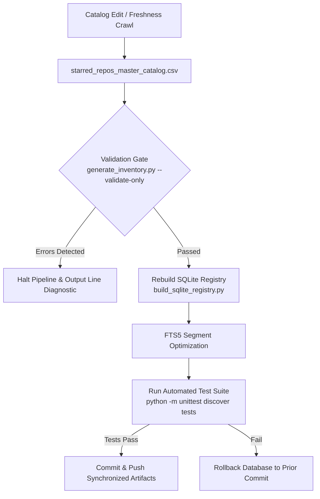

# Data Maintenance, Freshness & Synchronization Lifecycle

Maintaining an enterprise catalog of **11,730 repositories** requires structured data engineering practices. This document describes the data lifecycle, synchronization pipelines, schema drift detection, automated freshness protocols, and disaster recovery procedures.

---

## 1. Data Maintenance Architecture

All data operations follow a deterministic build and synchronization pipeline designed for zero data loss and automated validation:



---

## 2. Synchronization Pipelines

### 2.1 Rebuilding the SQLite FTS5 Database
Whenever `starred_repos_master_catalog.csv` is updated, the SQLite database at `registry/agents_registry.db` can be regenerated deterministically:

```bash
python scripts/inventory/build_sqlite_registry.py
```

#### Pipeline Operations:
1. **Atomic File Replacement**: Removes stale database and WAL journals cleanly.
2. **Schema Instantiation**: Creates relational `repositories` table, B-Tree indexes, and `repositories_fts` virtual table.
3. **Trigger Installation**: Installs automatic `AFTER INSERT`, `AFTER UPDATE`, and `AFTER DELETE` triggers.
4. **Batch Insertion**: Streams and inserts records in a single transactional block (`executemany`).
5. **FTS Optimization**: Executes `INSERT INTO repositories_fts(repositories_fts) VALUES('optimize');` to flatten inverted index b-trees into contiguous disk pages.

Execution benchmark: **1.48 seconds** for all 11,730 records.

---

### 2.2 Validating Schema Conformance
Before committing changes to the catalog, run the streaming schema validator:

```bash
python scripts/inventory/generate_inventory.py --validate-only
```

This validates every row against:
- `schemas/repository_schema.json` invariants
- Repository coordinate pattern (`owner/repo`)
- URL schema and validity
- Star and fork integer boundaries
- Category identifier bounds ($1 \le \text{ID} \le 55$)
- Architectural workflow pipeline presence and arrow syntax (` -> `)

---

### 2.3 Generating Export Artifacts
To regenerate `reports/repository-inventory.json` and `reports/repository-summary.md`:

```bash
python scripts/inventory/generate_inventory.py
```

---

## 3. Upstream Drift & Freshness Protocol

GitHub repositories continuously evolve: stargazers increment, repositories get renamed, transferred to organizations, or occasionally archived.

### Freshness Update Cycle
1. **Scheduled Batch Audits**:
   Star and fork metrics are periodically sampled via the GitHub REST/GraphQL API.
2. **Redirect & Relocation Handling**:
   When a repository moves (e.g. `openai/whisper` -> new org), the canonical URL and name coordinate are updated in the master CSV.
3. **Archived / Deprecated Repositories**:
   Archived repositories that preserve foundational scientific or algorithmic value (e.g., historical compilers or space guidance algorithms) are retained in the registry with their status noted.

---

## 4. Disaster Recovery & Zero Data Loss Policy

Github Ultimate Repos adheres to a strict **Zero-Loss Data Protection Policy**:

1. **Git-Tracked Immutability**:
   `starred_repos_master_catalog.csv` is committed directly to Git version control. Every modification, addition, or correction possesses a cryptographically signed Git commit hash.
2. **Ephemeral Database Reconstruction**:
   The SQLite database is treated as a compiled binary artifact. In the event of binary corruption, disk failure, or unintended deletion, running `python scripts/inventory/build_sqlite_registry.py` restores the full operational registry in under 2 seconds.
3. **No External Network Dependencies**:
   Database rebuilds and schema validations run completely offline without querying third-party APIs.

---

## 5. Automated CI Maintenance Workflows

The repository's integrity is guarded by GitHub Actions workflows in `.github/workflows/`:

- **`ci.yml`**: Runs on every `push` and `pull_request` to `main`, validating the entire catalog against Python 3.10, 3.11, and 3.12 matrices.
- **`registry_sync.yml`**: Triggers whenever `starred_repos_master_catalog.csv` changes, verifying that the master catalog row count remains exactly 11,730 and reporting any discrepancies.
- **`security_scan.yml`**: Runs on push and weekly on a cron schedule (`0 0 * * 1`), performing AST security analysis on all Python scripts.
