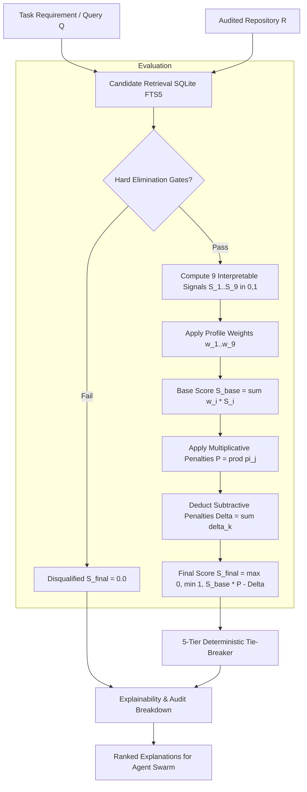
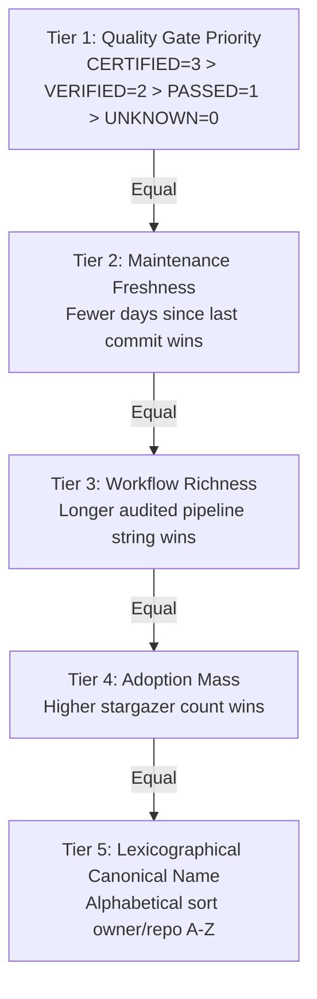

# Transparent Ranking System Architecture

Github Ultimate Repos provides discovery, evaluation, and selection across **11,730 audited open-source repositories** and **55 DeepTech disciplines**.

In high-capacity multi-agent architectures (ranging from hundreds to 10,000+ or 200,000+ autonomous agent swarms), tool and framework selection cannot rely on naive popularity metrics (such as raw GitHub stars) or black-box LLM intuitions. Vanity metrics routinely favor legacy, abandoned, unmaintained, or licensing-incompatible repositories over lean, secure, highly optimized alternatives.

The **Transparent Ranking System** delivers a mathematically normalized, 100% deterministic, fully explainable scoring engine with strict quality gates, penalty policies, and multi-tier tie-breaking.

---

## 1. Architectural Principles

1. **Deterministic Reproducibility**: Given identical repository metadata and task requirements, ranking produces the exact same ordinal position and scores across all environments, runtimes, and platforms.
2. **Normalized Interval Signals & Dual Bounding**: All 9 scoring signals are mathematically bounded to $[0.0, 1.0]$ and linearly projected to $[0, 100]$ score bounds (`score_100` and `SignalBreakdown.score_100`) for transparent human and agent interpretability.
3. **Zero Star Monopolization**: Stars and forks are logarithmically compressed so a 150,000-star legacy codebase does not crowd out an audited, zero-dependency, modern 4,000-star framework.
4. **Non-Bypassable Hard Elimination Gates**: Critical security vulnerabilities, incompatible licenses (e.g., AGPL in proprietary commercial SaaS), archived status, and OS platform incompatibilities immediately disqualify a candidate ($S_{\text{final}} = 0.0$).
5. **Full Explainability & Step Tracing**: Every ranking result produces an auditable breakdown detailing the raw signal values, applied weights, weighted contributions, multiplicative penalties, subtractive penalties, and narrative explanation.

---

## 2. High-Level Scoring Pipeline



---

## 3. The 9 Interpretable Scoring Signals

Each signal $S_i(R, Q) \in [0.0, 1.0]$ isolates an orthogonal dimension of repository fitness.

### Signal 1: Task Relevance ($S_{\text{task}}$)
Measures semantic, lexical, and categorical affinity between the task specification $Q$ and candidate repository $R$:
$$S_{\text{task}} = \min\left(1.0, \; 0.50 \cdot \text{Containment}(Q_{\text{tok}}, R_{\text{tok}}) + \text{Bonus}_{\text{phrase}} + \text{Bonus}_{\text{category}} + 0.10 \cdot \text{WorkflowMatch}(Q, R_{\text{wf}})\right)$$
- **Exact phrase match**: $+0.20$ when full query phrase appears verbatim in name or description.
- **Category affinity**: $+0.20$ when assigned discipline aligns with task category preference.
- **Workflow alignment**: Fractional overlap between task tokens and the audited $Input \to Processing \to Output$ workflow pipeline.

### Signal 2: Feature Fit ($S_{\text{feature}}$)
Measures coverage of explicit functional capabilities and operational primitives requested by the agent:
$$S_{\text{feature}} = 
\begin{cases} 
\min\left(1.0, \max\left(0.5, \frac{\text{len}(R_{\text{wf}})}{120}\right)\right) & \text{if } F_{\text{req}} = \emptyset \text{ and } F_{\text{opt}} = \emptyset \\
\frac{|F_{\text{req}} \cap R_{\text{surface}}|}{|F_{\text{req}}|} & \text{if } F_{\text{req}} \neq \emptyset \text{ and } F_{\text{opt}} = \emptyset \\
\frac{|F_{\text{opt}} \cap R_{\text{surface}}|}{|F_{\text{opt}}|} & \text{if } F_{\text{req}} = \emptyset \text{ and } F_{\text{opt}} \neq \emptyset \\
0.75 \cdot \frac{|F_{\text{req}} \cap R_{\text{surface}}|}{|F_{\text{req}}|} + 0.25 \cdot \frac{|F_{\text{opt}} \cap R_{\text{surface}}|}{|F_{\text{opt}}|} & \text{if } F_{\text{req}} \neq \emptyset \text{ and } F_{\text{opt}} \neq \emptyset 
\end{cases}$$

### Signal 3: Maintenance Evidence ($S_{\text{maint}}$)
Evaluates project stewardship vitality and commit cadence using an exponential half-life decay model ($\tau_{1/2} = 180 \text{ days}$):
$$\Lambda(t) = \exp\left( - \frac{\ln(2) \cdot t}{\tau_{1/2}} \right), \quad H_{\text{issues}} = \frac{N_{\text{closed}}}{N_{\text{closed}} + N_{\text{open}} + \epsilon}$$
$$S_{\text{maint}} = 0.65 \cdot \Lambda(t) + 0.35 \cdot H_{\text{issues}}$$
- $t \le 14$ days: $\Lambda(t) \ge 0.95$ (Active development).
- $t = 180$ days: $\Lambda(t) = 0.50$ (One half-life).
- $t \ge 730$ days (2 years): $\Lambda(t) \le 0.06$ (Severe maintenance deficit).

### Signal 4: Documentation Clarity ($S_{\text{docs}}$)
Quantifies whether an autonomous agent or developer can immediately deploy and integrate the tool without hallucination:
$$S_{\text{docs}} = 0.35 \cdot \mathbb{I}_{\text{workflow}} + 0.25 \cdot \mathbb{I}_{\text{quickstart}} + 0.20 \cdot \mathbb{I}_{\text{examples}} + 0.20 \cdot \min\left(1.0, \frac{\text{Chars}_{\text{README}}}{2500}\right)$$
- Audited 1-line pipeline workflow string ($Input \to Processing \to Output$) present: $\mathbb{I}_{\text{workflow}} = 1.0$.
- Quickstart guide present: $\mathbb{I}_{\text{quickstart}} = 1.0$.
- Runnable code examples present: $\mathbb{I}_{\text{examples}} = 1.0$.

### Signal 5: Compatibility ($S_{\text{compat}}$)
Assesses runtime, language, operating system, and dependency overhead:
$$S_{\text{compat}} = 0.35 \cdot \mathbb{I}_{\text{OS}} + 0.35 \cdot \mathbb{I}_{\text{Lang}} + 0.15 \cdot \mathbb{I}_{\text{Runtime}} + 0.15 \cdot (1.0 - \min(0.80, 0.015 \cdot N_{\text{dep}}))$$
- Zero external dependencies receives $1.0$ on the dependency footprint sub-factor.

### Signal 6: Security Signals ($S_{\text{sec}}$)
Assesses verified code hygiene, quality gate audit status, and CVE exposure:
$$S_{\text{sec}} = \min\left(1.0, \; \text{Score}_{\text{Gate}} \cdot \exp(-0.8 \cdot N_{\text{crit}} - 0.2 \cdot N_{\text{med}}) + 0.10 \cdot \mathbb{I}_{\text{policy}}\right)$$
- Quality Gate: `CERTIFIED` ($1.0$), `VERIFIED` ($0.85$), `PASSED` ($0.70$), `UNKNOWN` ($0.40$).
- Vulnerabilities decay the baseline exponentially.

### Signal 7: License Fit ($S_{\text{license}}$)
Scores license compliance against the task target policy:
- **`PERMISSIVE_ONLY`** (MIT, Apache-2.0, BSD, ISC): Permissive $= 1.0$, Weak Copyleft $= 0.50$, Strong Copyleft $= 0.10$, Proprietary $= 0.0$.
- **`WEAK_COPYLEFT_ALLOWED`** (LGPL, MPL): Permissive & Weak Copyleft $= 1.0$, Strong Copyleft $= 0.40$.
- **`ANY_OPEN_SOURCE`**: All OSI-approved licenses $= 1.0$.

### Signal 8: Maturity ($S_{\text{mat}}$)
Evaluates real-world validation without star monopolization using logarithmic compression:
$$S_{\text{mat}} = 0.65 \cdot \min\left(1.0, \frac{\log_{10}(1 + \text{Stars})}{\log_{10}(1 + 50,000)}\right) + 0.35 \cdot \min\left(1.0, \frac{\log_{10}(1 + \text{Forks})}{\log_{10}(1 + 10,000)}\right)$$

### Signal 9: Deployment Fit ($S_{\text{deploy}}$)
Measures packaging ease and hardware execution feasibility:
$$S_{\text{deploy}} = 0.50 \cdot \mathbb{I}_{\text{package\_manager}} + 0.50 \cdot \text{HardwareScore}$$
- CPU-only workloads penalize repositories that strictly mandate multi-GPU or cluster hardware.

---

## 4. Penalty Policies & Elimination Gates

### A. Hard Elimination Gates (Score = 0.0, Disqualified)
A candidate failing any of these conditions is instantly disqualified:
1. **Critical CVE Exposure**: $N_{\text{critical\_cve}} > \text{MaxAllowed}$ (default: $0$).
2. **Archived / Deprecated**: Repository is archived/read-only on GitHub when active tool maintenance is required.
3. **Disallowed License Category**: Repository uses Strong Copyleft (GPL) or Network Copyleft (AGPL) under `PERMISSIVE_ONLY` corporate policies.
4. **OS Platform Incompatibility**: Target OS (e.g. Windows) is not in the repository's supported operating system list.

### B. Soft Multiplicative Penalties ($\pi_j \in (0, 1]$)
When soft criteria are violated, multiplicative penalties scale down the base score:
- **Severe Stale Maintenance** ($> 730$ days since commit): $\pi = 0.50$.
- **Moderate Stale Maintenance** ($> 365$ days since commit): $\pi = 0.75$.
- **Missing / Unverified Workflow**: $\pi = 0.85$.
- **High Dependency Risk** ($> 30$ dependencies): $\pi = 0.85$.
- **Thin Documentation** ($< 400$ chars README): $\pi = 0.80$.

Total Multiplicative Multiplier:
$$P(R) = \prod_{j} \pi_j(R)$$

### C. Subtractive Penalties ($\delta_k \ge 0.0$)
Subtractive penalties deduct directly from the score:
- **Issue Backlog Skew** (open issues $> 10 \times$ closed issues): $\delta = 0.08$.
- **Medium Security Vulnerabilities**: $\delta = \min(0.15, 0.04 \cdot N_{\text{medium\_cves}})$.
- **Non-Verified Quality Gate** (`PASSED` or `UNKNOWN`): $\delta = 0.03$.

Total Subtractive Penalty:
$$\Delta(R) = \sum_{k} \delta_k(R)$$

### Final Score Formula
$$S_{\text{final}}(R, Q) = \max\left(0.0, \; \min\left(1.0, \; S_{\text{base}}(R, Q) \times P(R) - \Delta(R)\right)\right)$$

---

## 5. Configurable Weighting Profiles

Weights adapt the ranking engine to specific operational domains while strictly preserving $\sum w_i = 1.0$:

### Domain & Strategic Profiles

| Scoring Signal | BALANCED | STABILITY_FIRST | INNOVATION_FIRST | LIGHTWEIGHT |
| :--- | :---: | :---: | :---: | :---: |
| **Task Relevance ($S_{\text{task}}$)** | 0.18 | 0.14 | 0.26 | 0.20 |
| **Feature Fit ($S_{\text{feature}}$)** | 0.16 | 0.12 | 0.24 | 0.16 |
| **Maintenance Evidence ($S_{\text{maint}}$)** | 0.14 | 0.18 | 0.08 | 0.10 |
| **Documentation Clarity ($S_{\text{docs}}$)** | 0.10 | 0.10 | 0.10 | 0.10 |
| **Compatibility ($S_{\text{compat}}$)** | 0.12 | 0.12 | 0.10 | 0.20 |
| **Security Signals ($S_{\text{sec}}$)** | 0.12 | 0.18 | 0.05 | 0.06 |
| **License Fit ($S_{\text{license}}$)** | 0.08 | 0.08 | 0.04 | 0.05 |
| **Maturity ($S_{\text{mat}}$)** | 0.05 | 0.04 | 0.05 | 0.03 |
| **Deployment Fit ($S_{\text{deploy}}$)** | 0.05 | 0.04 | 0.08 | 0.10 |
| **Sum of Weights** | **1.00** | **1.00** | **1.00** | **1.00** |

### Workload & Production Profiles

| Scoring Signal | Enterprise Production | Fast Prototyping | Autonomous Swarm Agent | Safety-Critical |
| :--- | :---: | :---: | :---: | :---: |
| **Task Relevance ($S_{\text{task}}$)** | 0.18 | 0.25 | 0.22 | 0.15 |
| **Feature Fit ($S_{\text{feature}}$)** | 0.16 | 0.22 | 0.20 | 0.15 |
| **Maintenance Evidence ($S_{\text{maint}}$)** | 0.14 | 0.08 | 0.12 | 0.14 |
| **Documentation Clarity ($S_{\text{docs}}$)** | 0.10 | 0.10 | 0.14 | 0.10 |
| **Compatibility ($S_{\text{compat}}$)** | 0.12 | 0.12 | 0.10 | 0.12 |
| **Security Signals ($S_{\text{sec}}$)** | 0.12 | 0.05 | 0.08 | 0.20 |
| **License Fit ($S_{\text{license}}$)** | 0.08 | 0.03 | 0.04 | 0.06 |
| **Maturity ($S_{\text{mat}}$)** | 0.05 | 0.05 | 0.04 | 0.04 |
| **Deployment Fit ($S_{\text{deploy}}$)** | 0.05 | 0.10 | 0.06 | 0.04 |
| **Sum of Weights** | **1.00** | **1.00** | **1.00** | **1.00** |

---

## 6. Deterministic 5-Tier Tie-Breaking Criteria

When two or more repositories have identical final scores ($|S_A - S_B| < 10^{-5}$), ties are resolved deterministically using a 5-tier cascade:



This guarantees 100% deterministic reproducibility across multiple runs, machines, and operating systems.

---

## 7. Python Implementation & Usage

The implementation is located at:
- Core Engine: [`scripts/ranking/ranking_engine.py`](file:///C:/Users/Aryan/Github-Ultimate-Repos/scripts/ranking/ranking_engine.py)
- Package Module: [`scripts/ranking/__init__.py`](file:///C:/Users/Aryan/Github-Ultimate-Repos/scripts/ranking/__init__.py)
- Automated Unit Tests: [`tests/unit/test_ranking.py`](file:///C:/Users/Aryan/Github-Ultimate-Repos/tests/unit/test_ranking.py)

### CLI Command Example

Rank repositories against a task query directly from the SQLite registry:
```bash
python scripts/ranking/ranking_engine.py --query "transformer inference" --limit 5 --profile ENTERPRISE_PRODUCTION
```

Output JSON audit trail for multi-agent logging:
```bash
python scripts/ranking/ranking_engine.py --query "autonomous SLAM" --profile AUTONOMOUS_SWARM_AGENT --json
```

### Python API Example

```python
from scripts.ranking.ranking_engine import (
    TransparentRankingEngine,
    RepositoryMetadata,
    TaskRequirement,
    QualityGate,
    LicenseCategory,
)

# 1. Instantiate the Engine
engine = TransparentRankingEngine(default_profile="ENTERPRISE_PRODUCTION")

# 2. Define Task Requirements
task = TaskRequirement(
    query="distributed stream processing",
    required_features=["kafka", "exactly-once"],
    target_language="Python",
    target_os="windows",
    required_license_policy="PERMISSIVE_ONLY",
)

# 3. Rank Candidates
results = engine.rank(candidate_repos, task, top_k=5)

for r in results:
    print(f"Rank #{r.rank}: {r.repository} -> Final Score: {r.final_score:.4f}")
    print(f"Audit Narrative: {r.audit_narrative}")
```
