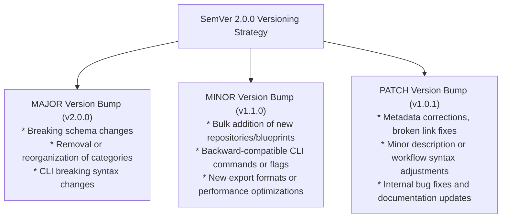

# Enterprise Release Engineering & Versioning Policy

This document governs the release lifecycle, semantic versioning policy, artifact generation procedures, cryptographic integrity verification, and rollback protocols for Github Ultimate Repos.

---

## 1. Semantic Versioning Specification (SemVer 2.0.0)

Github Ultimate Repos adheres to **Semantic Versioning 2.0.0** (`MAJOR.MINOR.PATCH`) applied to both data assets and tooling interfaces:



---

## 2. Release Cadence

- **Major Releases**: Annually or upon significant architectural overhauls (e.g. migration to new SQLite virtual table engines or ontology expansions).
- **Minor Releases**: Monthly or quarterly, synchronizing thousands of newly starred repositories, star count baselines, and new CLI capabilities.
- **Patch Releases**: As-needed for critical corrections, broken link remediations, or security patches.

---

## 3. Pre-Release Quality Checklist

Before tagging any official release, release engineers must execute the following sequential quality checklist:

```bash
# 1. Clean working directory
git status

# 2. Execute full catalog schema validation
python scripts/inventory/generate_inventory.py --validate-only

# 3. Rebuild and optimize SQLite FTS5 database
python scripts/inventory/build_sqlite_registry.py

# 4. Execute the automated test suite across all matrices
python -m unittest discover tests -v

# 5. Execute scale and performance benchmarking
python scripts/validation/benchmark_performance.py

# 6. Generate synchronized JSON and Markdown inventory reports
python scripts/inventory/generate_inventory.py
```

### Mandatory Quality Gate Invariants:
- All automated unit and integration tests (120+ tests across unit and integration suites) must pass with `OK`.
- Zero schema validation errors across all 11,730 records.
- Average query latency must measure $< 1.0\text{ ms}$.
- Total repository count must strictly match between CSV, SQLite, and JSON reports.

---

## 4. Release Artifact Bundling & Cryptographic Verification

Every release produces a standardized suite of release artifacts:

| Artifact Name | Format | Purpose |
| :--- | :--- | :--- |
| `agents_registry.db` | Binary (SQLite3 WAL) | High-speed offline query and FTS5 search database. |
| `starred_repos_master_catalog.csv` | Plain Text (UTF-8) | Authoritative human- and machine-readable master catalog. |
| `repository-inventory.json` | JSON (Draft-07) | Structured pre-validated inventory for programmatic consumption. |
| `performance-benchmarks.md` | Markdown | Benchmark telemetry and latency metrics. |
| `checksums.sha256` | Hash Manifest | Cryptographic verification manifest for all released files. |

### Generating Cryptographic Hashes (SHA-256)
On release, generate a SHA-256 checksum manifest to guarantee tamper-proof integrity:

#### Linux / macOS:
```bash
sha256sum starred_repos_master_catalog.csv registry/agents_registry.db reports/repository-inventory.json > checksums.sha256
```

#### Windows (PowerShell):
```powershell
Get-FileHash -Algorithm SHA256 starred_repos_master_catalog.csv, registry\agents_registry.db, reports\repository-inventory.json | Format-List > checksums.sha256
```

---

## 5. Tagging & GitHub Release Publishing

1. **Update `CHANGELOG.md`**:
   Document all additions, modifications, performance improvements, and bug fixes under the new release header.
2. **Commit and Tag**:
   ```bash
   git add CHANGELOG.md reports/
   git commit -m "chore(release): prepare v1.1.0 release"
   git tag -a v1.1.0 -m "Release v1.1.0: 11,730 Repositories across 55 Disciplines"
   git push origin main --tags
   ```
3. **Publish GitHub Release**:
   Create a release corresponding to tag `v1.1.0` on GitHub and attach `checksums.sha256` and `reports/repository-inventory.json`.

---

## 6. Rollback & Hotfix Protocols

If a release artifact exhibits data corruption or breaking defects post-release:

1. **Immediate Hotfix Branching**:
   Create a branch directly from the release tag:
   ```bash
   git checkout -b hotfix/v1.1.1 v1.1.0
   ```
2. **Defect Remediation**:
   Apply corrective edits to the master CSV or scripts.
3. **Regenerate & Re-verify**:
   Run the full pre-release quality checklist.
4. **Publish Hotfix**:
   Tag and publish `v1.1.1` and issue an advisory note on GitHub Releases.
