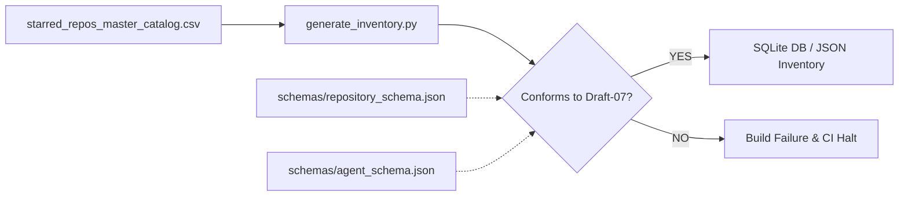

# Repository & Agent Capability Schema Specification

This document provides the definitive technical specification for all data schemas governed within Github Ultimate Repos, including `schemas/repository_schema.json` and `schemas/agent_schema.json`.

All cataloged repositories, exported records, and autonomous agent capabilities must strictly conform to these contracts.

---

## 1. Schema Architecture Overview

The catalog enforces schema governance using **JSON Schema Draft-07**. Every entry is strictly validated across multiple lifecycle points:
1. **Catalog Serialization**: Pre-commit verification against `starred_repos_master_catalog.csv`.
2. **Database Ingestion**: Type coercion and boundary checks during SQLite FTS5 table generation.
3. **CI/CD Quality Gates**: Automated validation via `scripts/inventory/generate_inventory.py --validate-only` in `.github/workflows/ci.yml`.



---

## 2. Repository Asset Schema (`schemas/repository_schema.json`)

The `RepositoryRecord` schema models a curated open-source repository asset.

### 2.1 Complete JSON Schema Contract
```json
{
  "$schema": "http://json-schema.org/draft-07/schema#",
  "title": "RepositoryRecord",
  "description": "Schema definition for an enterprise cataloged repository asset",
  "type": "object",
  "required": [
    "id",
    "name",
    "url",
    "stars",
    "forks",
    "language",
    "category_id",
    "category_name",
    "description",
    "architecture_workflow"
  ],
  "properties": {
    "id": {
      "type": "integer",
      "minimum": 1,
      "description": "Unique catalog sequence identifier"
    },
    "name": {
      "type": "string",
      "pattern": "^[^/]+/[^/]+$",
      "description": "Full GitHub repository name (owner/repo)"
    },
    "url": {
      "type": "string",
      "format": "uri",
      "description": "Canonical HTTPS URL to the repository"
    },
    "stars": {
      "type": "integer",
      "minimum": 0,
      "description": "Stargazer count at audit baseline"
    },
    "forks": {
      "type": "integer",
      "minimum": 0,
      "description": "Fork count at audit baseline"
    },
    "language": {
      "type": "string",
      "description": "Primary programming language or 'Other'"
    },
    "category_id": {
      "type": "integer",
      "minimum": 1,
      "maximum": 55,
      "description": "Assigned discipline category ID (1-55)"
    },
    "category_name": {
      "type": "string",
      "description": "Official title of the assigned discipline category"
    },
    "description": {
      "type": "string",
      "description": "Repository description or synopsis"
    },
    "architecture_workflow": {
      "type": "string",
      "minLength": 5,
      "description": "Verified 1-line architectural workflow pipeline"
    },
    "quality_gate": {
      "type": "string",
      "enum": [
        "PASSED",
        "VERIFIED",
        "CERTIFIED"
      ],
      "default": "VERIFIED",
      "description": "Enterprise audit quality gate status"
    }
  }
}
```

---

### 2.2 Field-by-Field Reference

| Field Name | Type | Constraints | Description & Example |
| :--- | :--- | :--- | :--- |
| `id` | `integer` | `minimum: 1` | Unique sequence position in catalog (1 to 11,730). |
| `name` | `string` | Regex `^[^/]+/[^/]+$` | Exact GitHub repository identifier (`owner/repo`), e.g. `vllm-project/vllm`. |
| `url` | `string` | URI format (`https://...`) | Canonical HTTPS web destination, e.g. `https://github.com/vllm-project/vllm`. |
| `stars` | `integer` | `minimum: 0` | Verified community stargazer count at audit baseline (e.g. `41250`). |
| `forks` | `integer` | `minimum: 0` | Verified repository fork count at audit baseline (e.g. `5890`). |
| `language` | `string` | Non-empty string | Primary programming language or `Other` (e.g. `Python`, `Rust`, `C++`). |
| `category_id` | `integer` | `1 <= id <= 55` | Canonical integer discipline index corresponding to the 55 taxonomy files. |
| `category_name` | `string` | Canonical name | Full title of the discipline category (e.g. `Artificial Intelligence, Large Language Models...`). |
| `description` | `string` | Text string | Clear, informative synopsis of the project's purpose and functionality. |
| `architecture_workflow` | `string` | `minLength: 5` | Formal 1-line pipeline syntax (`Input -> Processing -> Output`). |
| `quality_gate` | `string` | Enum | Quality gate compliance status: `PASSED`, `VERIFIED`, or `CERTIFIED`. |

---

## 3. Agent Capability Blueprint Schema (`schemas/agent_schema.json`)

To enable autonomous agent corporations and swarms to execute tools dynamically, repositories can be translated into `AgentSpecification` contracts.

### 3.1 JSON Schema Contract
```json
{
  "$schema": "http://json-schema.org/draft-07/schema#",
  "title": "AgentSpecification",
  "description": "Schema definition for an autonomous agent capability blueprint",
  "type": "object",
  "required": [
    "agent_id",
    "name",
    "category",
    "role",
    "capabilities",
    "architecture_workflow",
    "source_repository",
    "status"
  ],
  "properties": {
    "agent_id": {
      "type": "string",
      "pattern": "^AGENT-[0-9]{5}$",
      "description": "Standardized enterprise agent slot identifier"
    },
    "name": {
      "type": "string",
      "description": "Designated functional agent name"
    },
    "category": {
      "type": "string",
      "description": "Primary domain specialization"
    },
    "role": {
      "type": "string",
      "description": "Autonomous executive or specialist operational role"
    },
    "capabilities": {
      "type": "array",
      "items": {
        "type": "string"
      },
      "minItems": 1,
      "description": "List of core competencies and tool capabilities"
    },
    "architecture_workflow": {
      "type": "string",
      "description": "Execution pipeline definition"
    },
    "source_repository": {
      "type": "string",
      "description": "Backing open-source framework or tool repository"
    },
    "status": {
      "type": "string",
      "enum": [
        "active",
        "ready",
        "validated",
        "prototype"
      ],
      "default": "ready"
    }
  }
}
```

### 3.2 Concrete Agent Specification Example
```json
{
  "agent_id": "AGENT-00108",
  "name": "High-Throughput LLM Serving Specialist",
  "category": "Artificial Intelligence, Large Language Models & Quantization",
  "role": "Autonomous Inference Optimization Agent",
  "capabilities": [
    "PagedAttention KV-cache management",
    "Continuous request batching",
    "Tensor parallel multi-GPU orchestration",
    "AWQ and GPTQ weight quantization"
  ],
  "architecture_workflow": "Prompt Batch -> PagedAttention Distributed Runtime -> Low-Latency Token Stream",
  "source_repository": "vllm-project/vllm",
  "status": "validated"
}
```

---

## 4. Architectural Workflow Pipeline Standard

Every repository record must include a verified `architecture_workflow` adhering to the following structural pattern:

$$\text{Input Domain} \longrightarrow \text{Core Transformation / Algorithm} \longrightarrow \text{Output Artifact}$$

### Syntax Rules:
1. **Delimiters**: Stages must be separated by the ASCII arrow sequence ` -> ` (space, hyphen, greater-than, space).
2. **Stage Conciseness**: Each stage must clearly identify the data type or operational mechanism.
3. **Completeness**: Generic placeholders such as `Data -> Process -> Result` or `TBD` are rejected by validation gates.

---

## 5. Programmatic Validation in Python

You can validate any repository dictionary programmatically using the Python standard library and `schemas/repository_schema.json`:

```python
import json
import re
from urllib.parse import urlparse

def validate_repository_record(record: dict) -> list[str]:
    """Validates a repository record against standard schema invariants."""
    errors = []
    
    # Check required fields
    required = ["id", "name", "url", "stars", "forks", "language", "category_id", "category_name", "description", "architecture_workflow"]
    for field in required:
        if field not in record:
            errors.append(f"Missing required field: {field}")

    # Validate name regex pattern
    if "name" in record and not re.match(r"^[^/]+/[^/]+$", str(record["name"])):
        errors.append(f"Invalid repository coordinate: {record.get('name')}")

    # Validate URL
    if "url" in record:
        parsed = urlparse(record["url"])
        if not parsed.scheme.startswith("http") or not parsed.netloc:
            errors.append(f"Invalid repository URL: {record.get('url')}")

    # Validate numeric ranges
    if record.get("stars", 0) < 0:
        errors.append("Stars cannot be negative")
    if record.get("forks", 0) < 0:
        errors.append("Forks cannot be negative")
    if not (1 <= record.get("category_id", 0) <= 55):
        errors.append(f"category_id {record.get('category_id')} out of range [1, 55]")

    # Validate workflow arrow syntax
    if " -> " not in record.get("architecture_workflow", ""):
        errors.append("architecture_workflow must contain standard ' -> ' arrow delimiter")

    return errors
```

---

## 6. Complete Schema Suite Reference (`schemas/`)

Github Ultimate Repos enforces formal JSON Schema (Draft-07) contracts across all architectural tiers:

| Schema File | Schema Title | Purpose & Primary Consumers |
| :--- | :--- | :--- |
| [`repository_schema.json`](../schemas/repository_schema.json) | `RepositoryRecord` | Canonical record specification for all 11,730 indexed repositories. |
| [`agent_schema.json`](../schemas/agent_schema.json) | `AgentSpecification` | Autonomous agent capability blueprint for dynamic tool dispatch. |
| [`workflow_schema.json`](../schemas/workflow_schema.json) | `EnterpriseWorkflowSpecification` | Multi-stage production development workflow pipelines and quality gates. |
| [`stack_blueprint_schema.json`](../schemas/stack_blueprint_schema.json) | `StackBlueprintSpecification` | Turnkey technology stack blueprints with SLAs and failure mitigations. |
| [`comparison_schema.json`](../schemas/comparison_schema.json) | `RepositoryComparisonMatrix` | Side-by-side trade-off evaluations, scorecards, and scenario winners. |
| [`taxonomy_schema.json`](../schemas/taxonomy_schema.json) | `DisciplineTaxonomySpecification` | 55-discipline taxonomy metadata, domain boundaries, and keyword mappings. |
| [`mcp_tools_schema.json`](../schemas/mcp_tools_schema.json) | `MCPToolManifest` | Model Context Protocol tool declarations and JSON-RPC input schemas. |
| [`agent_discovery_schema.json`](../schemas/agent_discovery_schema.json) | `AgentDiscoverySpecification` | Dynamic agent discovery endpoints, parameters, and response contracts. |

