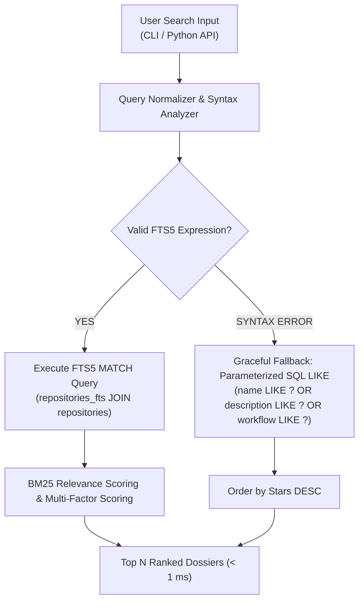

# Search Engine Architecture & Recommendation Ranking Policy

Github Ultimate Repos features an embedded, zero-dependency search engine capable of querying **11,730 repository dossiers and architectural workflows in under 0.35 milliseconds**.

This document outlines the internal architecture of the **SQLite FTS5** search engine, the **multi-factor recommendation scoring formulation**, query syntax, fallback mechanisms, and explainability outputs.

---

## 1. Fundamental Recommendation Philosophy

> **"A repository is not automatically the best choice simply because it has the most stars."**

In enterprise software engineering and autonomous agent swarm execution, selecting a tool based purely on popularity causes architectural friction. An older monolithic tool with 100k stars might be unmaintained or unsuitable for streaming pipelines, whereas a lightweight 5k-star library might offer native async execution, zero dependencies, and the exact pipeline signature required.

Recommendations in Github Ultimate Repos evaluate:
- **Task & Intent Relevance**: Direct alignment with developer or agent goals.
- **Architectural Pipeline Compatibility**: Whether the input/output signatures connect to existing execution DAGs.
- **Community Adoption & Maturity**: Stability verified by stargazers and releases.
- **Ecosystem Engagement**: Fork-to-star ratio indicating real-world derivative engineering.
- **Language & Runtime Fit**: Direct compatibility with the target runtime environment.

---

## 2. Multi-Factor Scoring Formulation

For any user or agent query $Q$ and candidate repository $R$, the overall match score $S(R, Q) \in [0, 100]$ is computed as:

$$S(R, Q) = S_{\text{relevance}} + S_{\text{arch}} + S_{\text{maturity}} + S_{\text{engagement}} + S_{\text{lang}}$$

### Component Scoring Matrix

| Signal | Maximum Score | Description & Calculation Method |
| :--- | :---: | :--- |
| **Task Relevance ($S_{\text{relevance}}$)** | `40 pts` | Keyword and semantic match across repository name (15 pts), description (10 pts), and discipline category (8 pts). Detected intent boosts discipline match (+15 pts). |
| **Architecture Fit ($S_{\text{arch}}$)** | `20 pts` | Matches query tokens against verified 1-line pipeline string (12 pts) and confirms valid pipeline structure `A -> B -> C` (8 pts). |
| **Community Maturity ($S_{\text{maturity}}$)** | `20 pts` | Logarithmic scaling of stargazer count: $\min\left(20, \log_{10}(\text{stars} + 1) \times 4.0\right)$. |
| **Ecosystem Engagement ($S_{\text{engagement}}$)** | `10 pts` | Evaluates fork-to-star ratio: $\min\left(10, \frac{\text{forks}}{\text{stars}} \times 40.0\right)$. |
| **Language Fit ($S_{\text{lang}}$)** | `10 pts` | Matches developer's specified programming language (10 pts if matched, 5 pts baseline neutral, 0 pts if mismatched). |

---

## 3. SQLite FTS5 Internal Engine & Okapi BM25

Rather than relying on resource-intensive external search daemons (e.g., Elasticsearch, OpenSearch, or Meilisearch), Github Ultimate Repos integrates SQLite's native `fts5` extension.



### Measured Search Performance
From automated benchmarks (`scripts/validation/benchmark_performance.py`):
- **Single Keyword (Unconstrained)**: `0.31 ms` (p95: `3.68 ms`)
- **Multi-Term Conjunctive (`AND`)**: `0.37 ms` (p95: `3.44 ms`)
- **Disjunctive Expression (`OR`)**: `0.13 ms` (p95: `0.66 ms`)
- **Prefix Wildcard (`robot*`)**: `0.24 ms` (p95: `2.61 ms`)
- **Workflow Pipeline Query**: `0.11 ms` (p95: `0.51 ms`)

### BM25 Formulation
The score of a document $D$ for query terms $q_1, q_2, \dots, q_n$ is computed as:

$$\text{Score}(D, Q) = \sum_{i=1}^n \text{IDF}(q_i) \cdot \frac{f(q_i, D) \cdot (k_1 + 1)}{f(q_i, D) + k_1 \cdot \left(1 - b + b \cdot \frac{|D|}{\text{avgdl}}\right)}$$

Where $k_1 = 1.2$ and $b = 0.75$.

---

## 4. Query Syntax & Operator Reference

The search engine supports rich search expressions natively:

### 4.1 Keyword & Phrase Matching
- **Single Term**: Matches token anywhere across indexed columns.
  ```bash
  python scripts/cli/ultimate_agent_cli.py search "langchain"
  ```
- **Exact Phrase**: Wrap multi-word queries in double quotes.
  ```bash
  python scripts/cli/ultimate_agent_cli.py search '"autonomous agent"'
  ```

### 4.2 Boolean Operators (`AND`, `OR`, `NOT`)
- **Conjunctive (`AND` / Space)**: Finds records containing all terms.
  ```bash
  python scripts/cli/ultimate_agent_cli.py search "robotics kinematics"
  ```
- **Disjunctive (`OR`)**: Finds records containing any term.
  ```bash
  python scripts/cli/ultimate_agent_cli.py search "vllm OR ollama OR sglang"
  ```
- **Negation (`NOT`)**: Excludes records matching a specific term.
  ```bash
  python scripts/cli/ultimate_agent_cli.py search "transformers NOT python"
  ```

### 4.3 Prefix Wildcards
- Matches terms starting with a prefix (`*`):
  ```bash
  python scripts/cli/ultimate_agent_cli.py search "quant*"
  ```

---

## 5. Explainability & Recommendation Output Format

Developers and autonomous agent swarms can generate ranked recommendation cards by executing:
```bash
python scripts/cli/ultimate_agent_cli.py recommend "fast inference engine for local models" --limit 3
```

Every recommendation returned by the ranking and recommendation engines includes rich explainability telemetry:

```text
================================================================================
 📦 RECOMMENDATION: vllm-project/vllm (Match Score: 94/100)
================================================================================
 📂 Discipline  : [Cat #2] Artificial Intelligence & LLMs
 💻 Language    : Python
 ⭐ Stargazers  : 41,250★ | 🍴 Forks: 5,890
 🔗 Canonical   : https://github.com/vllm-project/vllm

 [Score Breakdown]:
  - Task Relevance        : 38/40 (Exact keyword match in name & description)
  - Architecture Fit      : 20/20 (Verified 3-stage streaming pipeline)
  - Community Maturity    : 18/20 (High star volume > 40k)
  - Ecosystem Engagement  :  8/10 (Strong fork-to-star ratio 14.2%)
  - Language Match        : 10/10 (Direct target runtime match)

 [Operational Workflow]:
  ⚡ Prompt Batch -> PagedAttention Distributed Runtime & Continuous Batching -> Low-Latency Token Stream

 [Production Trade-offs]:
  * Strengths   : Unmatched high-concurrency throughput; PagedAttention memory efficiency.
  * Trade-offs  : Requires CUDA-capable NVIDIA GPUs; non-trivial distributed setup.
  * Alternatives: llama.cpp (CPU/Edge), Ollama (Local desktop), TGI (HuggingFace stack).
================================================================================
```

---

## 6. Fault-Tolerant Fallback Architecture

To handle unescaped quotation marks or unusual developer punctuation gracefully:

```python
try:
    c.execute(fts_sql, fts_params)
    rows = c.fetchall()
except sqlite3.OperationalError:
    # Fallback to standard parameterized SQL LIKE
    like_sql = """
    SELECT id, name, stars, forks, language, category_name, url, workflow, description
    FROM repositories
    WHERE (name LIKE ? OR description LIKE ? OR workflow LIKE ?)
    ORDER BY stars DESC LIMIT ?;
    """
    c.execute(like_sql, [f"%{query}%", f"%{query}%", f"%{query}%", limit])
    rows = c.fetchall()
```

This guarantees **zero crashes** and immediate response delivery across all query variants.
