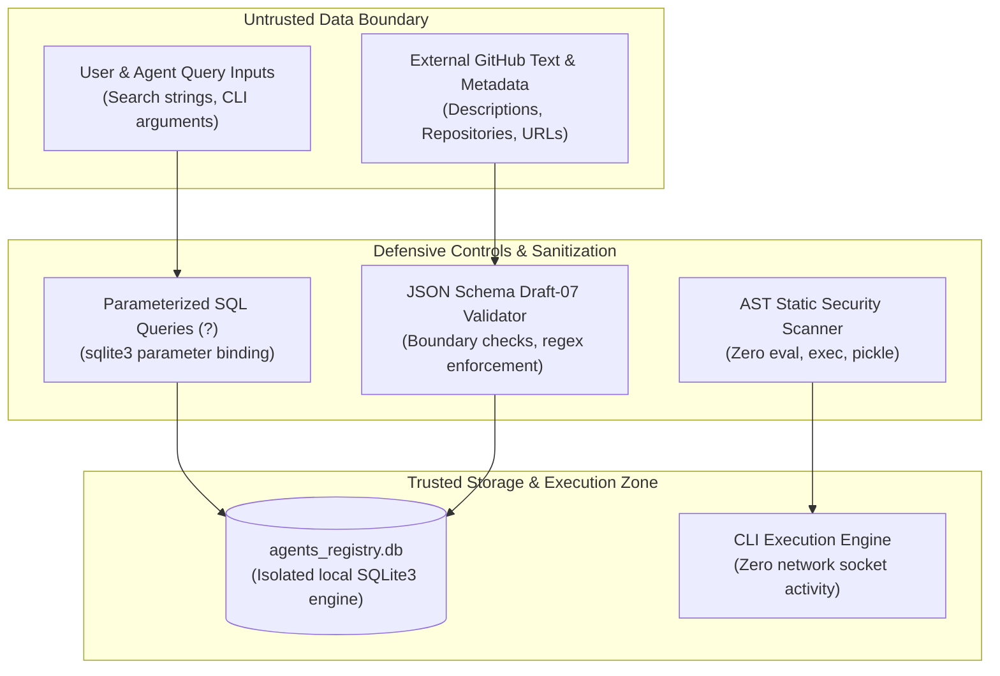

# Security Architecture & Policies

Security and integrity are paramount in Github Ultimate Repos. This document details our threat modeling, defensive controls, SQL injection mitigations, AST static security analysis, supply-chain guarantees, and vulnerability reporting procedures.

---

## 1. Threat Modeling & Trust Boundaries

Github Ultimate Repos serves as a discovery and tool-resolution index. The security perimeter is defined by three strict architectural boundaries:



### Core Security Guarantees:
1. **Zero Arbitrary Execution**:
   The platform stores metadata only. It **never** downloads, fetches, compiles, or executes code from external repositories automatically.
2. **Zero Remote Socket Activity**:
   Core CLI operations, database queries, and test suites operate entirely offline with zero outbound network calls.
3. **No Secret Storage**:
   The repository contains zero hardcoded API tokens, SSH keys, private certificates, or credentials.

---

## 2. SQL Injection Prevention

SQL injection vulnerabilities in database search interfaces typically occur when user inputs are directly concatenated or formatted into query strings.

### The 100% Parameterized Query Rule
In Github Ultimate Repos, **all SQL queries use native parameter placeholders (`?`)**. String formatting, f-strings, and string concatenations within SQL statements are strictly banned and audited:

```python
# SECURE (Enforced Standard):
c.execute("""
    SELECT r.id, r.name, r.stars, r.workflow
    FROM repositories_fts f
    JOIN repositories r ON f.rowid = r.id
    WHERE repositories_fts MATCH ?
    ORDER BY r.stars DESC LIMIT ?;
""", [query_term, limit_count])

# INSECURE (Banned & Prohibited):
# c.execute(f"SELECT * FROM repositories WHERE name = '{user_input}';")
```

---

## 3. AST Static Security Scanning (`security_scan.yml`)

The codebase incorporates an automated Abstract Syntax Tree (AST) scanner executed during every CI workflow and weekly security audit.

The scanner analyzes Python code at the AST level, identifying and halting on any invocation of dangerous built-in execution functions:
- `eval()`
- `exec()`
- `pickle.loads()` / `pickle.load()`
- `os.system()` with unsanitized inputs

```python
# Excerpt from .github/workflows/security_scan.yml
unsafe_calls = {'eval', 'exec', 'pickle.loads'}
for py_file in glob.glob('**/*.py', recursive=True):
    with open(py_file, 'r', encoding='utf-8') as f:
        tree = ast.parse(f.read(), filename=py_file)
    for node in ast.walk(tree):
        if isinstance(node, ast.Call):
            if isinstance(node.func, ast.Name) and node.func.id in unsafe_calls:
                raise SecurityVulnerabilityError(f"Prohibited call to {node.func.id} at {py_file}:{node.lineno}")
```

---

## 4. Supply Chain Security & Zero External Dependencies

Modern software architectures face severe supply-chain risks, including compromised npm/PyPI packages, typo-squatting, and dependency confusion.

### Zero Third-Party Wheel Architecture
Github Ultimate Repos neutralizes supply-chain attack vectors by design:
- **No `requirements.txt` or `package.json`**: The core repository uses only the standard library modules: `sqlite3`, `csv`, `json`, `argparse`, `sys`, `os`, `re`, `time`, and `unittest`.
- **No Build-Time Package Installations**: CI/CD jobs do not execute `pip install` or `npm install` for core operations.
- **Hermetic Reproducibility**: Builds remain identical across systems and immune to upstream upstream package deprecations or hijackings.

---

## 5. CI/CD Least Privilege Principle

GitHub Actions workflows are configured under the principle of least privilege:
```yaml
permissions:
  contents: read
```

Workflows cannot write to repository branches, access organization secrets, or push artifacts unless explicitly gated and reviewed.

---

## 6. Vulnerability Disclosure & Reporting

If you discover a security flaw or vulnerability within Github Ultimate Repos, please review [SECURITY.md](../SECURITY.md) and report it responsibly:

- **Private Reporting**: Open a private advisory report through GitHub's Security Advisories tab.
- **Direct Contact**: Contact the maintainers directly at the security contact address listed in `SECURITY.md`.
- **SLA**: Initial response within 48 hours; remediation patch within 7 business days.
