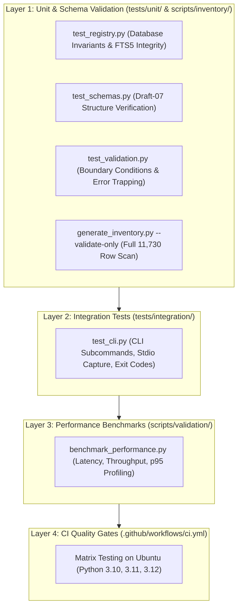

# Testing & Quality Engineering Architecture

Github Ultimate Repos enforces rigorous quality engineering standards to guarantee that catalog metadata, database structures, search queries, and CLI commands perform with zero defects.

This guide details the test pyramid, automated test suites, schema validation procedures, performance benchmarks, and CI/CD quality gates.

---

## 1. Testing Pyramid & Strategy

The quality architecture consists of four distinct verification layers:



---

## 2. Test Suites Overview

### 2.1 Unit Tests (`tests/unit/`)
- **`test_registry.py`**:
  - Invariant: Database contains exactly **11,730** repository records.
  - Invariant: `repositories_fts` virtual table contains exactly **11,730** synchronized documents.
  - Invariant: Catalog maps to exactly **55** unique DeepTech categories.
  - Functional: FTS5 keyword matching queries return populated results in sub-millisecond time.
- **`test_schemas.py`**:
  - Verifies that all 8 JSON Schema Draft-07 contracts (`repository_schema`, `agent_schema`, `workflow_schema`, `stack_blueprint_schema`, `comparison_schema`, `taxonomy_schema`, `mcp_tools_schema`, `agent_discovery_schema`) are structurally sound.
- **`test_validation.py`**:
  - Tests boundary conditions: negative star rejection, invalid repository coordinate formats (`missing_slash`), invalid category ID boundaries ($< 1$ or $> 55$), and missing operational workflow pipelines.
- **`test_ranking.py`**:
  - Verifies the Transparent Ranking Engine's 9 scoring signals, weight profile normalization ($\sum w_i = 1.0$), hard elimination gates, and deterministic 5-tier tie-breaking.
- **`test_recommendation.py` & `test_intelligent_recommendation.py`**:
  - Validates intent archetype classification, capability extraction, multi-factor scoring (Task Fit, Maintenance, Language, License, Deploy), anti-slop bookmark penalties, and recommendation card synthesis.
- **`test_provenance.py`**:
  - Audits SPDX machine-readable licensing compliance, cryptographic release commit hashes, and dataset lineage tracking.
- **`test_tradeoff_engine.py`**:
  - Validates side-by-side multi-dimensional trade-off comparisons, scorecard generation, and scenario winner selections.
- **`test_taxonomy.py`**:
  - Verifies the 55 DeepTech disciplines, domain boundaries, cluster mappings, and markdown file resolution.
- **`test_workflows.py`**:
  - Verifies the 6 enterprise production workflows, Draft-07 schema compliance, YAML/JSON mirroring, and referential integrity against `agents_registry.db`.
- **`test_blueprints.py`**:
  - Tests the 5 turnkey stack blueprints, SLA definitions, failure mitigations, and quickstart commands.
- **`test_security.py`**:
  - Executes AST static security analysis, audits against forbidden execution sinks (`eval`, `exec`), and tests SQL injection defenses.
- **`test_accessibility.py`**:
  - Validates `index.html` against WCAG 2.2 AA accessibility requirements, ARIA landmarks, keyboard navigation shortcuts, and responsive layouts.

### 2.2 Integration Tests (`tests/integration/`)
- **`test_cli.py`**:
  - Validates foundational CLI commands (`stats`, `search`, `get`, `category`).
- **`test_cli_advanced.py`**:
  - Validates advanced CLI operations (`recommend`, `workflow --list`, `workflow --interactive`).
- **`test_compare_cli.py`**:
  - Validates the side-by-side `compare` command across terminal, markdown, and JSON output formats.
- **`test_mcp_server.py`**:
  - Validates Model Context Protocol (MCP) JSON-RPC 2.0 stdio server initialization, tool listing, and tool invocation.

---

## 3. Running the Test Suite

### 3.1 Executing All Automated Tests via Pytest
Run the entire comprehensive test suite with `pytest`:

```bash
pytest tests/ -v
```

### 3.2 Executing via Python Standard Library Unittest
To execute tests using only Python's built-in `unittest` runner without external test frameworks:

```bash
python -m unittest discover tests -v
```

### 3.3 Running Specific Test Subsystems
```bash
# Test database registry and FTS5 search
pytest tests/unit/test_registry.py -v

# Test 9-signal transparent ranking engine
pytest tests/unit/test_ranking.py -v

# Test intelligent recommendation engine
pytest tests/unit/test_intelligent_recommendation.py -v

# Test enterprise workflows & blueprints
pytest tests/unit/test_workflows.py tests/unit/test_blueprints.py -v

# Test MCP server stdio integration
pytest tests/integration/test_mcp_server.py -v

# Test CLI integration suite
pytest tests/integration/ -v
```

---

## 4. Full Catalog Schema Validation

In addition to unit test assertions, the entire master catalog (`starred_repos_master_catalog.csv`) can be validated in streaming mode:

```bash
python scripts/inventory/generate_inventory.py --validate-only
```

This verifies that all **11,730 individual rows** satisfy every constraint defined in `schemas/repository_schema.json` and reports any syntax or boundary violation.

---

## 5. Performance Benchmarking & Scale Validation

Performance regressions are caught using `scripts/validation/benchmark_performance.py`:

```bash
python scripts/validation/benchmark_performance.py
```

### Latency Threshold Invariants:
- Unconstrained Single-Term Search: **Avg < 1.0 ms**
- Multi-Term Conjunctive Search: **Avg < 1.0 ms**
- 95th Percentile Latency (p95): **< 5.0 ms**
- Streaming Ingestion Throughput: **> 30,000 records/sec**

The script automatically generates a detailed benchmark report saved to `reports/performance-benchmarks.md`.

---

## 6. Continuous Integration (CI) Quality Gates

Every push and pull request to the `main` branch triggers the GitHub Actions CI workflow (`.github/workflows/ci.yml`), which executes the following quality gates in order:

1. **Python Matrix**: Validates compatibility across Python `3.10`, `3.11`, and `3.12`.
2. **Catalog Validation**: Runs `generate_inventory.py --validate-only`.
3. **Database Build**: Reconstructs `registry/agents_registry.db` from scratch.
4. **Automated Test Suite**: Executes `python -m unittest discover tests -v`.
5. **CLI Verification**: Runs `ultimate_agent_cli.py stats` and sample search queries.

A failure at any stage halts the pipeline, preventing broken data or code from entering production.
