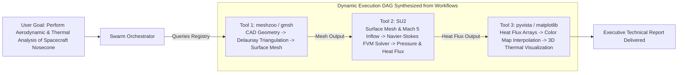

# Operational Architecture Workflow Engine

Github Ultimate Repos pioneers **100% Operational Architecture Workflow Coverage** across all **11,730 cataloged software assets and autonomous agent blueprints**.

Every repository includes a verified 1-line pipeline string adhering to the standardized format:
$$\text{Input Domain} \longrightarrow \text{Core Transformation / Engine} \longrightarrow \text{Output Artifact}$$

This document explains the technical standard, syntax rules, agent dynamic DAG synthesis, and automated quality validation.

---

## 1. Why 1-Line Operational Workflows Matter

In enterprise multi-agent swarms (e.g., 10,000 to 200,000 autonomous agents), agents cannot afford the token budget or compute latency required to read entire codebases, README files, or architecture documentation to determine how a tool works.

By providing a crisp, deterministic pipeline signature:
1. **Dynamic DAG Synthesis**: Autonomous orchestrators can chain repositories into end-to-end execution directed acyclic graphs (DAGs) automatically.
2. **Semantic Matching**: High-dimensional embeddings or FTS5 queries against the `workflow` column resolve functional capability matches instantaneously.
3. **Deterministic Verification**: Human engineers and auditing bots can immediately verify that a project performs the exact operations expected before integrating it into production pipelines.

---

## 2. Syntax & Structural Grammar Specification

Every workflow string must adhere to the following formal grammar (EBNF notation):

```ebnf
workflow         ::= input_stage " -> " processing_stage " -> " output_stage
input_stage      ::= description_of_inputs
processing_stage ::= description_of_algorithms_or_engines
output_stage     ::= description_of_output_artifacts
```

### Invariant Constraints
- **Delimiter**: Stages must be separated by the exact ASCII sequence ` -> ` (space, hyphen, greater-than, space).
- **Minimum Length**: The string must be at least 15 characters long.
- **Stage Specificity**: Nouns must describe concrete data structures (e.g. `Raw Point Cloud`, `AST`, `QASM Circuit`), and verbs must denote concrete computational actions (e.g. `Featherstone Recursion`, `LALSuite Matched Filtering`, `PagedAttention Batching`).
- **Placeholder Prohibition**: Generic placeholders such as `Input -> Processing -> Output` or `Code -> Build -> Artifact` are strictly prohibited and rejected by CI quality gates.

---

## 3. Autonomous Swarm Dynamic DAG Orchestration

When an autonomous agent receives a multi-step objective, it queries `agents_registry.db` to discover candidate tools, parses their `workflow` strings, and connects outputs to subsequent inputs:



### Parsing Pipeline Code Example
Autonomous agents can parse and compose workflows in Python using standard string splitting:

```python
def parse_workflow(workflow_str: str) -> dict[str, str]:
    """Deconstructs a workflow pipeline string into distinct execution stages."""
    stages = [s.strip() for s in workflow_str.split(" -> ")]
    if len(stages) < 3:
        raise ValueError(f"Invalid workflow pipeline: {workflow_str}")
    
    return {
        "input": stages[0],
        "processing": " -> ".join(stages[1:-1]),
        "output": stages[-1]
    }

# Example
pipeline = parse_workflow("Prompt Batch -> PagedAttention Distributed Runtime -> Low-Latency Token Stream")
print(pipeline["input"])       # Prompt Batch
print(pipeline["processing"])  # PagedAttention Distributed Runtime
print(pipeline["output"])      # Low-Latency Token Stream
```

---

## 4. Cross-Domain Exemplars

Below are representative architectural workflows demonstrating the standard across various DeepTech disciplines:

### 1. Artificial Intelligence & LLMs (`vllm-project/vllm`)
```text
Prompt Batch -> PagedAttention Distributed Runtime & Continuous Batching -> Low-Latency Token Stream
```

### 2. Robotics & Dynamics (`stack-of-tasks/pinocchio`)
```text
URDF/SDF Model -> Spatial Vector Lie Algebra & Featherstone Algorithms -> Kinematic Jacobian & Joint Torques
```

### 3. Space Systems & Astrodynamics (`poliastro/poliastro`)
```text
Initial Orbital State Vectors -> Cowell Propagator & Ephemeris DE440 -> Cartesian Trajectory Coordinates
```

### 4. Semiconductor & EDA (`The-OpenROAD-Project/OpenLane`)
```text
Verilog RTL -> Yosys Synthesis & OpenROAD Floorplanning/Routing -> GDSII Fabrication Mask File
```

### 5. Quantum Computing (`Qiskit/qiskit`)
```text
Quantum Circuit -> Solovay-Kitaev Gate Transpilation & QASM Optimization -> Statevector / QPU Measurement Counts
```

### 6. Cloud-Native & Kubernetes (`kubernetes/kubernetes`)
```text
Declarative YAML Spec -> API Server & Controller Reconciliation Loop -> Etcd State Synchronization & Container Pods
```

### 7. Medical Imaging & DICOM AI (`Project-MONAI/MONAI`)
```text
3D Volumetric CT DICOM -> HU Calibration & SwinUNETR Segmentation -> Voxel Mask & 3D Tumor Coordinates
```

### 8. Cybersecurity & Reverse Engineering (`NationalSecurityAgency/ghidra`)
```text
ELF/PE Binary Bytecode -> Decompiler AST & Control Flow Graph Reconstruction -> C-Pseudocode Decompilation
```

---

## 5. Automated Quality Gate & CI Verification

The integrity of all 11,730 workflows is enforced by automated tests in `tests/unit/test_validation.py` and `.github/workflows/ci.yml`.

```python
# Validation criteria applied to every record:
def verify_workflow(workflow: str, repo_name: str):
    assert workflow, f"{repo_name}: workflow cannot be empty"
    assert " -> " in workflow, f"{repo_name}: missing ' -> ' delimiter"
    parts = [p.strip() for p in workflow.split(" -> ")]
    assert len(parts) >= 3, f"{repo_name}: expected at least 3 stages (Input -> Processing -> Output)"
    for idx, part in enumerate(parts):
        assert len(part) >= 3, f"{repo_name}: stage {idx+1} too short ('{part}')"
```

Any pull request introducing malformed, truncated, or placeholder workflows fails CI automatically.

---

## 6. Curated Multi-Stage End-to-End Enterprise Workflows

Beyond individual 1-line pipeline signatures, **Github Ultimate Repos** provides complete, production-grade end-to-end workflow specifications located in [`workflows/`](../workflows/). Each workflow is fully formalized under [`schemas/workflow_schema.json`](../schemas/workflow_schema.json) and mirrored in both JSON and YAML formats.

Every workflow stage defines:
1. **Sequential Stage Position & Purpose**: Explicit business and technical objective.
2. **Recommended Repositories**: Authoritative GitHub repositories with verified star counts, category assignments, canonical URLs, and stage-specific roles.
3. **Structured Input/Output Handoffs**: Upstream sources, downstream consumers, artifact names, and data serialization formats (e.g. JSON Schema, Pydantic, OpenAPI, Parquet, gRPC).
4. **Prerequisites & Dependencies**: Runtimes, hardware requirements, and foundational models.
5. **Architectural Alternatives**: Viable open-source or commercial alternatives paired with transparent trade-off analyses.
6. **Enforced Quality Gates**: Measurable pass/fail criteria (e.g. TTFT latency, test pass rates, zero-drift verification) required before advancing.

### The 6 Core Enterprise Workflows

| ID | Workflow Title | Domain | Stages | Governance Standard |
|---|---|---|:---:|---|
| **WORKFLOW-001** | Production AI Agent Enterprise Lifecycle | AI & Autonomous Agent Swarms | 7 | 7-Gate Enterprise Governance |
| **WORKFLOW-002** | Cross-Platform Mobile Application Lifecycle | Mobile Engineering | 7 | Mobile App Store Zero-Crash Standard |
| **WORKFLOW-003** | Cloud-Native Kubernetes & GitOps Platform | DevOps & Platform Engineering | 7 | Zero-Drift GitOps Standard |
| **WORKFLOW-004** | High-Velocity Full-Stack SaaS MVP | Full-Stack Web & SaaS Acceleration | 7 | High-Conversion & Security Standard |
| **WORKFLOW-005** | Cybersecurity Pentest & Vulnerability Lab | Red Teaming & Offensive Security | 6 | Authorized Zero-Collateral Standard |
| **WORKFLOW-006** | Autonomous Search Intelligence, GEO & AEO | Search & Generative Engine Opt. | 6 | OmniSearch Dual-Optimization |

---

## 7. Curated Technology Stack Blueprints

For developers seeking plug-and-play technology stacks, [`blueprints/`](../blueprints/) provides turnkey architectural specifications governed by [`schemas/stack_blueprint_schema.json`](../schemas/stack_blueprint_schema.json).

Each blueprint is indexed in [`blueprints/index.json`](../blueprints/index.json) and provides:
- **Multi-Tier Decomposition**: Primary component with exact rationale and trade-offs, plus cataloged alternatives.
- **End-to-End Workflow String**: Compact linear pipeline sequence.
- **Data Flow Stages**: Step-by-step telemetry contracts with verification checks.
- **Production Readiness Matrix**: Target SLAs, security considerations, and failure modes with mitigations.
- **Automated Quickstart**: Concrete shell commands and starter configuration/code.

### Curated Blueprints Catalog

1. **`BP-AI-AGENT-01`**: Production Autonomous AI Agent & Swarm Stack
   - *Primary Stack*: `stanfordnlp/dspy` + `langchain-ai/langgraph` + `qdrant/qdrant` + `langfuse/langfuse`
   - *Target SLA*: 99.9% uptime, p99 generation latency < 1500ms
2. **`BP-SAAS-MVP-02`**: High-Velocity Startup Full-Stack SaaS MVP Stack
   - *Primary Stack*: `vercel/next.js` + `fastapi/fastapi` + `supabase/supabase` + `better-auth/better-auth` + `coollabsio/coolify`
   - *Target SLA*: 99.95% uptime, p95 API latency < 120ms
3. **`BP-EDGE-AI-03`**: Local-First, Offline-Capable Edge AI & Desktop Stack
   - *Primary Stack*: `ggml-org/llama.cpp` + `tursodatabase/libsql` + `tauri-apps/tauri`
   - *Target SLA*: 100% offline functionality, sub-100MB idle memory footprint
4. **`BP-DATA-PIPELINE-04`**: High-Throughput Enterprise Lakehouse & Data Pipeline
   - *Primary Stack*: `apache/kafka` + `apache/iceberg` + `dbt-labs/dbt` + `apache/airflow`
   - *Target SLA*: 99.99% ingestion availability, end-to-end data latency < 5 minutes
5. **`BP-CYBER-PENTEST-05`**: Enterprise Cybersecurity Defense & Pentest Lab
   - *Primary Stack*: `projectdiscovery/subfinder` + `projectdiscovery/nuclei` + `rapid7/metasploit-framework` + `NationalSecurityAgency/ghidra` + `wazuh/wazuh`
   - *Target SLA*: Complete test isolation, forensic logging of all emulation actions

### Programmatic Discovery via Recommendation Engine
Developers and autonomous agents can discover blueprints matching their technical requirements:
```python
from scripts.engine.recommendation_engine import RecommendationEngine

engine = RecommendationEngine()
rec = engine.recommend_blueprint("build an enterprise lakehouse pipeline with kafka and iceberg")
print(f"Matched Blueprint: {rec['blueprint']['name']} (Confidence: {rec['confidence']})")
```

---

## 8. Quality Assurance & Automated Test Validation

The workflow and blueprint engines are validated by automated unit tests in `tests/unit/`:
- **[`test_workflows.py`](../tests/unit/test_workflows.py)**: Validates schema conformance, Draft-07 compliance, YAML-JSON mirroring, 100% repository existence in `agents_registry.db`, and hand-off/gate completeness.
- **[`test_blueprints.py`](../tests/unit/test_blueprints.py)**: Validates stack blueprint schema compliance, tier components, database referential integrity, production readiness SLAs, and recommendation engine matching.

