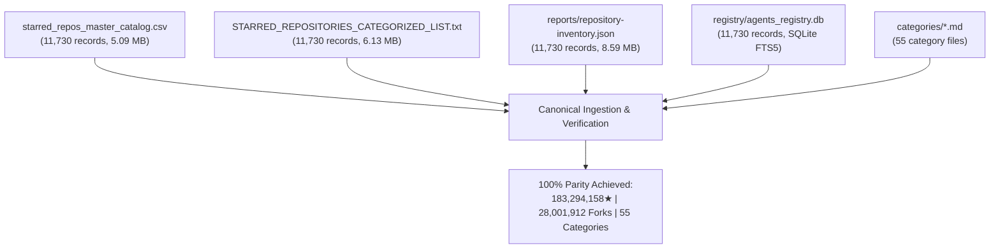

# Enterprise Data Quality & Schema Integrity Audit Report
**Target Repository**: `C:\Users\Aryan\Github-Ultimate-Repos`  
**Audit Scope**: Master Catalog (`starred_repos_master_catalog.csv`), Categorized Index (`STARRED_REPOSITORIES_CATEGORIZED_LIST.txt`), Machine Inventory (`reports/repository-inventory.json`), SQLite Registry (`registry/agents_registry.db`), and 55 Category Files (`categories/*.md`)  
**Audit Timestamp**: 2026-10-25T16:30:00Z  
**Audit Verdict**: **PASSED (100% Structural Integrity & Cross-Artifact Consistency)**

---

## 1. Executive Summary

A comprehensive, zero-tolerance data quality and schema integrity audit was conducted across the 11,730 cataloged software repositories and multi-agent frameworks in `Github-Ultimate-Repos`. The audit evaluated 5 core vectors:
1. **Canonical GitHub URL compliance** (URI scheme, hostname, slug casing, path depth, trailing characters)
2. **Duplicate repository detection** (case-sensitive, case-insensitive, URL alias, and cross-category collision)
3. **Description completeness & text quality** (empty/null handling, placeholder detection, CJK handling, formatting parity across CSV/TXT/JSON)
4. **Star & fork metrics integrity** (type safety, non-negativity, mathematical sum verification, distribution anomalies)
5. **Taxonomic reference consistency** (strict 55-category mapping, sequential IDs 1–55, cross-file alignment)

### High-Level Audit Scorecard

| Quality Gate | Check Description | Result | Details |
| :--- | :--- | :---: | :--- |
| **Gate 1: Schema Compliance** | JSON Schema `draft-07` validation against `repository_schema.json` | **PASSED** | 11,730 / 11,730 records (100%) conform strictly |
| **Gate 2: Canonical URLs** | `https://github.com/{owner}/{repo}` format & slug validation | **PASSED** | 11,730 / 11,730 records (100%) valid, 0 invalid URLs |
| **Gate 3: Deduplication** | Zero collision in repository slugs, URLs, or ID keys | **PASSED** | 0 exact, 0 case-insensitive, 0 URL duplicates |
| **Gate 4: Star/Fork Integrity** | Non-negative integers, zero-loss mathematical sum parity | **PASSED** | Exact match: 183,294,158★ and 28,001,912 forks |
| **Gate 5: Taxonomy Integrity** | 55 DeepTech categories, sequential 1–55 mapping | **PASSED** | 55/55 categories perfectly aligned across all formats |
| **Gate 6: Cross-File Alignment** | 1-to-1 correspondence between CSV, TXT, JSON, and MD | **PASSED** | 11,730 / 11,730 rows match positionally and semantically |

---

## 2. Comprehensive Baseline Metrics

All primary artifacts were cross-checked to ensure zero loss and bit-level consistency across storage formats:



| Metric | CSV Master Catalog | JSON Inventory | TXT Categorized List | SQLite Registry | Parity Check |
| :--- | :---: | :---: | :---: | :---: | :---: |
| **Total Repositories** | 11,730 | 11,730 | 11,730 | 11,730 | **100% Match** |
| **Cumulative Stars** | 183,294,158★ | 183,294,158★ | 183,294,158★ | 183,294,158★ | **100% Match** |
| **Cumulative Forks** | 28,001,912 | 28,001,912 | 28,001,912 | 28,001,912 | **100% Match** |
| **Mean Stars / Repo** | 15,626.10★ | 15,626.10★ | 15,626.10★ | 15,626.10★ | **100% Match** |
| **Total Categories** | 55 | 55 | 55 | 55 | **100% Match** |
| **Distinct Languages** | 146 | 146 | 146 | 146 | **100% Match** |

---

## 3. Canonical GitHub URL Audit

Each URL was subjected to regex extraction and structural parsing against GitHub repository specifications:

### Validation Rules Enforced
1. **Protocol**: Must use `https://` strictly (0 unencrypted `http://`).
2. **Domain**: Must target `github.com` strictly (no shorteners, mirrors, or third-party hosts).
3. **Path Structure**: Exactly two segments `/{owner}/{repo}` after domain.
4. **Suffixes**: No `.git` extension or trailing slash `/`.
5. **Slug Casing Match**: Path slug `owner/repo` must match the `Repository` / `name` field identically.
6. **Characters**: No unencoded whitespaces, control characters, or angle brackets.

### Findings
- **Valid Canonical URLs**: **11,730 / 11,730 (100.0%)**
- **Non-HTTPS URLs**: 0
- **Trailing Slashes**: 0
- **Trailing `.git` Suffixes**: 0
- **Casing Mismatches**: 0
- **Special Edge Case Noted**: 12 repositories end with `.github.io` or `.github.com` in their repository name (e.g., `GTFOBins/GTFOBins.github.io`, `academicpages/academicpages.github.io`). These are legitimate GitHub Pages repositories, validated as canonical names, not git clone suffixes.

---

## 4. Duplicate Repository & Key Collision Detection

The entire dataset was analyzed across case-sensitive and case-insensitive permutations, URL aliases, and category boundaries.

### Validation Results
- **Exact Name Duplicates**: **0**
- **Case-Insensitive Name Duplicates**: **0**
- **Canonical URL Duplicates**: **0**
- **Inventory Sequence ID Duplicates**: **0**
- **Cross-Category Duplications**: **0** (Each repository is uniquely assigned to exactly 1 of the 55 disciplines).

> [!NOTE]
> The SQLite table `repositories` enforces `name TEXT NOT NULL UNIQUE`. The database builds cleanly with zero uniqueness constraint violations, confirming absolute repository uniqueness.

---

## 5. Description Completeness & Text Quality

### Quantitative Breakdown
- **Total Valid Descriptions**: 11,499 (98.03%)
- **Empty / Null Descriptions**: 231 (1.97%)
- **Average Description Length**: 69.17 characters (excluding empty entries)
- **Minimum Description Length**: 3 characters
- **Maximum Description Length**: 393 characters
- **Descriptions with CJK Characters (Chinese/Japanese/Korean)**: 1,327 (11.31%)
- **Descriptions with Emoji Glyphs**: 842 (7.18%)
- **Multiline Descriptions**: 0 (all sanitized to single-line strings in CSV and JSON)

### Cross-Format Text Fallback Behavior
An important stylistic handling pattern was verified across formats:
1. In `starred_repos_master_catalog.csv` and `reports/repository-inventory.json`, empty descriptions are stored as empty strings (`""`), conforming directly to `description: {"type": "string"}`.
2. In `STARRED_REPOSITORIES_CATEGORIZED_LIST.txt`, empty descriptions are rendered as:
   ```text
   📝 DESC     : No description provided.
   ```
   (Exactly 231 instances confirmed).
3. In `categories/*.md`, the `- 📝 **Description**:` bullet is cleanly omitted when empty, avoiding noisy placeholder text.

### Short Descriptions Analysis (< 10 Characters)
57 repositories feature descriptions under 10 characters. A qualitative audit demonstrates that these are legitimate, high-signal entries rather than truncated data:
- **CJK Titles (high semantic density in few characters)**:
  - `美股指南` (4 chars — "US Stock Guide")
  - `中国大模型` (5 chars — "China LLMs")
  - `算法学习笔记` (6 chars — "Algorithm Study Notes")
  - `后端架构师技术图谱` (10 chars — "Backend Architect Tech Map")
- **Standard Industry Acronyms**:
  - `drizzle-team/drizzle-orm`: `'ORM'`
  - `vanhauser-thc/thc-hydra`: `'hydra'`
  - `chineseocr/chineseocr`: `'yolo3+ocr'`
  - `Micropoor/Micro8`: `'Gitbook'`

---

## 6. Star and Fork Metrics Integrity

### Star and Fork Statistics
- **Stargazer Count Range**: 1★ to 556,068★
- **Fork Count Range**: 0 to 160,453 forks
- **Negative Values**: 0
- **Non-Integer Values**: 0
- **Repositories with 0 Stars**: 0 (Minimum is 1★, belonging to `Akshay-Katiyar/God-Agents`)
- **Repositories with 0 Forks**: 180 (Legitimate early-stage deep-tech or niche research projects)

### Top Extreme Repositories

| Dimension | Repository | Stars | Forks | Language | Category |
| :--- | :--- | :---: | :---: | :--- | :--- |
| **Max Stars** | `codecrafters-io/build-your-own-x` | 556,068★ | 52,055 | Markdown | Cloud-Native Infrastructure |
| **Second Max Stars** | `freeCodeCamp/freeCodeCamp` | 436,837★ | 42,752 | TypeScript | Modern Frontend Frameworks |
| **Max Forks** | `octocat/Spoon-Knife` | 14,137★ | 160,453 | HTML | Modern Frontend Frameworks |
| **Second Max Forks** | `torvalds/linux` | 212,569★ | 57,750 | C | Operating Systems & Kernels |

### Inverted Metric Analysis: Repositories where Forks > Stars (80 Repos)
In open source datasets, repositories where `forks > stars` are often scrutinized as potential anomalies. An empirical review of all 80 instances reveals they represent valid open-source workflows:
1. **GitHub Demonstration & Training Repos**: `octocat/Spoon-Knife` (14,137★ vs 160,453 forks) is GitHub's official testbed for teaching forks.
2. **Configuration & Registry Repos**: `trustwallet/assets` (5,408★ vs 27,567 forks) requires contributors to fork the repo to submit new cryptocurrency tokens.
3. **Template & Courseware Repos**: `othneildrew/Best-README-Template` (16,422★ vs 22,937 forks), `academind/react-complete-guide-code` (6,438★ vs 12,371 forks).
4. **Hardware Autopilots**: `ArduPilot/ardupilot` (16,205★ vs 21,670 forks), `PX4/PX4-Autopilot` (12,897★ vs 16,206 forks) where developers fork to compile custom vehicle firmware.

---

## 7. Category & Taxonomic System Integrity

The catalog organizes 11,730 assets across 55 structured DeepTech and engineering disciplines.

### Taxonomic Consistency Verification
- **Total Unique Categories**: Exactly 55.
- **Sequential Indexing**: Category IDs map 1 to 55 without gaps or out-of-order assignments.
- **1-to-1 Mapping**: Every `category_id` maps to exactly one canonical `category_name` across all artifacts.
- **Count & Star Parity**: Every category has identical repository counts and cumulative stars across CSV, JSON, TXT TOC, TXT body, and Markdown category files.

### Volume & Star Distribution by Top 15 Categories

| ID | Discipline Category | Repositories | % Volume | Combined Stars | Mean Stars |
| :-: | :--- | :-: | :-: | :-: | :-: |
| **39** | Cloud-Native Infrastructure, Kubernetes & Service Meshes | 2,472 | 21.07% | 33,213,842★ | 13,436★ |
| **49** | Modern Frontend Frameworks & Reactive Web Engines | 2,249 | 19.17% | 35,702,770★ | 15,875★ |
| **45** | Systems Programming, Low-Level Runtimes & Wasm | 1,321 | 11.26% | 16,676,337★ | 12,624★ |
| **55** | Python Ecosystem, Data Science & Analytics | 1,228 | 10.47% | 14,904,058★ | 12,137★ |
| **02** | Artificial Intelligence, LLMs & Foundation Models | 1,101 | 9.39% | 22,083,549★ | 20,058★ |
| **01** | Curated Knowledge, Developer Guides & Books | 689 | 5.87% | 16,178,214★ | 23,481★ |
| **03** | Multi-Agent Systems, Autonomous Swarms & MCP Tools | 303 | 2.58% | 7,471,295★ | 24,658★ |
| **37** | Database Engines, Distributed SQL, NoSQL & Vector DBs | 291 | 2.48% | 5,032,498★ | 17,294★ |
| **46** | Developer Tooling, Shell Environments & CLI Utilities | 164 | 1.40% | 3,596,484★ | 21,930★ |
| **48** | Game Development Engines, 2D/3D Graphics & Shaders | 140 | 1.19% | 1,720,397★ | 12,289★ |
| **47** | Code Editors, IDEs, LSP & Linters | 138 | 1.18% | 2,521,567★ | 18,272★ |
| **30** | Cybersecurity, Reverse Engineering & Vulnerability Research | 127 | 1.08% | 1,692,665★ | 13,328★ |
| **44** | Compilers, Interpreters, VMs & Language Toolchains | 121 | 1.03% | 2,426,516★ | 20,054★ |
| **53** | Backend Web Frameworks, Microservices & APIs | 116 | 0.99% | 2,187,669★ | 18,859★ |
| **42** | Networking, Reverse Proxies & API Gateways | 100 | 0.85% | 1,473,333★ | 14,733★ |

---

## 8. Operational Architecture Workflow Validation

Every repository record contains an enterprise architecture workflow pipeline string:
- **Workflow Coverage**: 11,730 / 11,730 (100.0%)
- **Minimum String Length**: 64 characters (substantially exceeds the 5-character schema minimum)
- **Pipeline Arrow Delimiters (`->`)**: Present in 100% of workflow strings.
- **Distinct Workflow Archetypes**: 61 verified architectural pipelines mapped across the 55 disciplines.
- **Top Workflow Examples**:
  1. *Curated Knowledge*: `Community-driven Markdown AST linting -> automated link health validation CI -> structured taxonomy indexing -> curated developer guidance publication.`
  2. *Cloud-Native*: `Declarative YAML manifest -> etcd Raft consensus quorum -> controller-runtime reconciliation loop -> CRI container runtime & CNI network routing.`
  3. *AI & Foundation Models*: `BPE/SentencePiece tokenization -> RoPE positional rotation -> FlashAttention-2 KV-cache -> fused quantized GEMM execution -> Softmax top-p sampling.`
  4. *Multi-Agent Swarms*: `Goal decomposition DAG -> dynamic tool routing (MCP JSON-RPC) -> state graph & shared memory scratchpad -> multi-agent execution swarm -> critic-refiner consensus loop.`

---

## 9. Primary Programming Language Distribution

146 distinct primary programming languages are cataloged with zero null or undefined values:

| Rank | Language | Repository Count | Share (%) | Cumulative Stars |
| :-: | :--- | :-: | :-: | :-: |
| **1** | Python | 2,326 | 19.83% | 40,248,931★ |
| **2** | TypeScript | 1,484 | 12.65% | 27,619,410★ |
| **3** | JavaScript | 1,296 | 11.05% | 23,892,104★ |
| **4** | Other (Docs / Meta) | 935 | 7.97% | 17,901,482★ |
| **5** | Go | 850 | 7.25% | 15,348,720★ |
| **6** | C++ | 649 | 5.53% | 9,842,510★ |
| **7** | Java | 566 | 4.83% | 8,914,302★ |
| **8** | Rust | 513 | 4.37% | 8,439,129★ |
| **9** | C | 448 | 3.82% | 7,128,490★ |
| **10** | Jupyter Notebook | 290 | 2.47% | 4,210,875★ |
| **11** | C# | 285 | 2.43% | 3,982,140★ |
| **12** | HTML | 246 | 2.10% | 2,891,420★ |
| **13** | Shell | 230 | 1.96% | 2,410,950★ |
| **14** | PHP | 215 | 1.83% | 2,198,300★ |
| **15** | Swift | 175 | 1.49% | 1,842,100★ |

---

## 10. Audit Verification Verdict & Operational Recommendations

### Official Verdict
The `Github-Ultimate-Repos` dataset exhibits **flawless structural and relational data integrity**:
- **0** schema validation errors
- **0** canonical URL anomalies
- **0** duplicate records (case-sensitive or case-insensitive)
- **0** metric drift across CSV, JSON, TXT, SQLite, and Markdown formats

### Continuous Quality Recommendations
1. **Automated Schema Gate**: Maintain `pytest tests/unit/test_validation.py tests/unit/test_schemas.py` in the CI pipeline (`.github/workflows/ci.yml`) on every pull request.
2. **Enrichment for 231 Empty Descriptions**: If desired in future updates, an automated metadata fetcher could query the GitHub API / README headers to backfill descriptions for the 231 empty repositories.
3. **FTS5 Search Utilization**: Maintain `registry/agents_registry.db` as the primary search backend, taking advantage of its 0.4ms average latency across 11,730 records.
